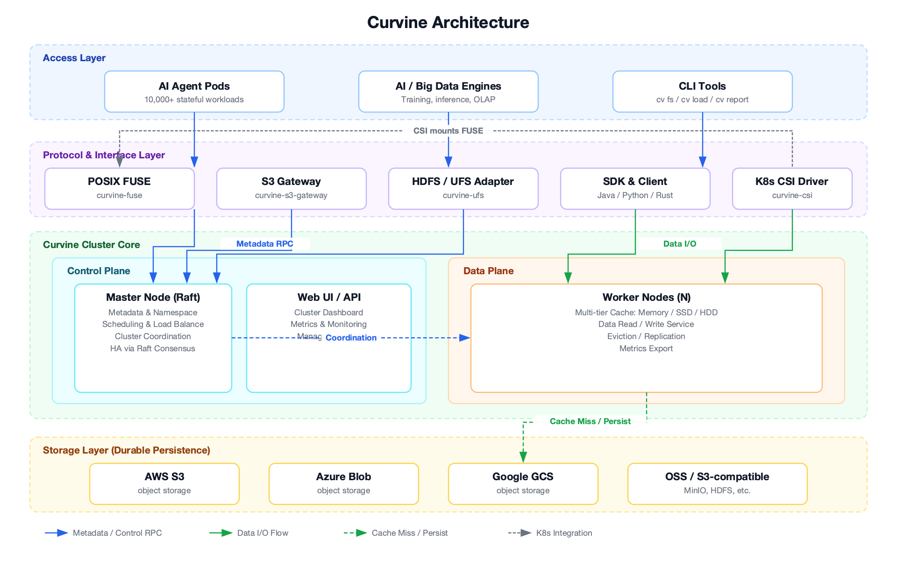

<div align=center>

</div>


<p align="center">
  English |
  <a href="https://github.com/CurvineIO/curvine/blob/main/README_zh.md">简体中文</a> |
  <a href="https://readme-i18n.com/CurvineIO/curvine?lang=de">Deutsch</a> |
  <a href="https://readme-i18n.com/CurvineIO/curvine?lang=es">Español</a> |
  <a href="https://readme-i18n.com/CurvineIO/curvine?lang=fr">français</a> |
  <a href="https://readme-i18n.com/CurvineIO/curvine?lang=ja">日本語</a> |
  <a href="https://readme-i18n.com/CurvineIO/curvine?lang=ko">한국어</a> |
  <a href="https://readme-i18n.com/CurvineIO/curvine?lang=pt">Português</a> |
  <a href="https://readme-i18n.com/CurvineIO/curvine?lang=ru">Русский</a>
</p>

<p align="center">
  <a href="https://www.cncf.io/projects/curvine/"></a>
  <a href="https://landscape.cncf.io/?item=runtime--cloud-native-storage--curvine"></a>
  <a href="https://github.com/CurvineIO/curvine/releases"></a>
  <a href="https://opensource.org/licenses/Apache-2.0"></a>
  <a href="https://www.rust-lang.org"></a>
  <a href="https://scorecard.dev/viewer/?uri=github.com/CurvineIO/curvine"></a>
</p>

<p align="center">
  <a href="https://join.slack.com/t/curvineio/shared_invite/zt-4673r43cn-prajma_q5ZI3BUxuaY5kiQ"></a>
</p>

<p align="center">
  <b>The AI-native, cloud-native file system.</b><br>
  Full POSIX semantics on top of object storage, with a built-in multi-tier distributed cache.<br>
  Built in Rust for AI training, inference, and AI agent platforms.
</p>

<p align="center">
  <a href="#-quick-start">Quick Start</a> ·
  <a href="https://curvineio.github.io/docs/">Documentation</a> ·
  <a href="#-performance">Benchmarks</a> ·
  <a href="#-community">Community</a>
</p>

---

## ✨ Why Curvine

Object storage is cheap and durable, but AI workloads expect a fast local file system. Curvine sits between the two: your data stays in S3 (or any compatible store), and your applications see a POSIX file system backed by a memory, SSD, and HDD cache.

- **Fast enough for GPUs.** In an [MLPerf Storage v2.0 comparison](https://curvineio.github.io/blog/2026/09/07/mlperf-storage-curvine-vs-alluxio) on the same AWS instance types, open-source Curvine beat Alluxio Enterprise AI's submitted results on accelerator utilization in 6 of 8 runs.
- **Real POSIX compatibility.** The FUSE mount [passed 1,129 Linux Test Project (LTP) file system tests with zero failures](https://curvineio.github.io/blog/2026/08/11/curvine-ltp-compatibility), so tools like `git`, Vite, and `inotify` work without changes.
- **Built for agents at scale.** A single cluster holds 5 billion files. On Kubernetes, a new volume is just a `mkdir`, so you can [run 10,000+ stateful agent pods on EKS](https://curvineio.github.io/blog/2026/07/07/ai-agent-storage-curvine-eks) without per-volume cloud API calls.
- **Proven with LLM inference.** AWS published a reference architecture for [tiered KV cache on Amazon SageMaker HyperPod with Curvine](https://aws.amazon.com/blogs/machine-learning/tiered-kv-cache-for-large-llms-on-amazon-sagemaker-hyperpod-with-curvine/).
- **No lock-in.** Files map 1:1 to object paths in S3. Data persisted to your bucket stays readable as plain objects, even when Curvine is down.

## 🚀 Quick Start

### Try it with Docker

Start a single-node demo cluster (one master, one worker) with one command:

```bash
curl -fsSL https://curvineio.github.io/install.sh | bash
```

The script prints the Web UI address and the commands for inspecting and removing the containers.

### Deploy on Kubernetes

```bash
helm repo add curvineio https://curvineio.github.io/helm-charts
helm repo update

# Curvine cluster
helm upgrade --install curvine curvineio/curvine -n curvine --create-namespace

# CSI driver, once the cluster is reachable
helm upgrade --install curvine-csi curvineio/curvine-csi -n curvine-system --create-namespace
```

See the [Helm charts](https://github.com/CurvineIO/curvine-helm) for configuration and the [CSI driver guide](https://curvineio.github.io/docs/User-Manuals/K8S-CSI-Driver/) for creating a `StorageClass`.

### Build and run from source

Follow the [build instructions](https://curvineio.github.io/docs/Deploy/build-instructions/) to produce a package in `build/dist`, then:

```bash
cd build/dist
export CURVINE_MASTER_HOSTNAME=localhost
./bin/curvine-master.sh start
./bin/curvine-worker.sh start
./bin/curvine-fuse.sh start   # mounts at /curvine-fuse

bin/cv report                 # check cluster status
bin/cv fs mkdir /hello
ls /curvine-fuse
```

To stop, run the same scripts with `stop` in reverse order: `curvine-fuse.sh`, `curvine-worker.sh`, then `curvine-master.sh`.

Web UIs: master at `http://<host>:9001`, worker at `http://<host>:9002`.

The [Quick Start guide](https://curvineio.github.io/docs/Deploy/quick-start/) covers each step in detail.

## 📈 Use Cases


| Use case | What Curvine does |
| --- | --- |
| **AI agent platform storage** | Gives tens of thousands of stateful agent pods their own POSIX workspaces, provisioned in milliseconds, with no per-node volume limits. |
| **LLM training** | Caches datasets and checkpoints next to GPU nodes so training spends less time waiting on I/O. |
| **Model distribution** | Distributes model weights across regions through the cache instead of pulling from object storage on every node. |
| **Multimodal data lakes** | Serves images, video, and Lance datasets over POSIX without copying them to local disk. |
| **OLAP acceleration** | Caches hot data for compute-storage separated engines such as StarRocks. |
| **Multi-cloud caching** | Puts one cache layer in front of object storage from different cloud providers. |

<details>
<summary><b>See each use case in action</b></summary>

**AI agent platform storage**


**LLM training**


**Model distribution**


**Multimodal data lakes**


**OLAP acceleration**


**Multi-cloud caching**


</details>

## 🏗️ Architecture



Curvine has four layers, color-coded in the diagram above:

- **Access layer.** The workloads on top: AI agent pods, training and inference jobs, OLAP and big-data engines, and the `cv` CLI.
- **Protocol layer.** Existing tools connect without code changes through POSIX (FUSE), an S3-compatible gateway, the Hadoop FileSystem API, Java/Python/Rust SDKs, or the Kubernetes CSI driver.
- **Cluster core.**
  - The *control plane* is a Raft-replicated **master** that owns metadata, the namespace, scheduling, and cluster coordination. It also serves the Web UI and metrics.
  - The *data plane* is a set of **workers** that serve data from a memory → SSD → HDD cache, promoting hot data and evicting cold data automatically.
- **Storage layer.** Object storage keeps the durable copy: AWS S3, Azure Blob Storage, Google Cloud Storage, Alibaba Cloud OSS, MinIO, any other S3-compatible store, or HDFS.

Metadata requests go to the master over RPC. Data flows directly between clients and workers. On a cache miss, workers read from object storage, and writes are persisted back to it. On Kubernetes, the CSI driver exposes the FUSE mount as a PVC, so creating a volume only creates a directory and takes milliseconds.

## 🧩 Features

| Area | Details |
| --- | --- |
| **Access** | POSIX via FUSE (`open`, `read`, `write`, `seek`, `rename`, `list`), S3 gateway, Hadoop FileSystem API, Java/Python/Rust SDKs |
| **Kubernetes** | CSI driver with dynamic provisioning, `Immediate` binding, and volume expansion; Helm charts for the cluster |
| **Storage backends** | AWS S3, Azure Blob Storage, Google Cloud Storage, Alibaba Cloud OSS, MinIO and other S3-compatible stores, HDFS |
| **Caching** | Memory → SSD → HDD tiers, automatic hot-data promotion, eviction, and replication |
| **Performance** | Rust and Tokio async I/O, zero-copy data paths, no garbage collector; around 100 µs latency and over 100K QPS sustained |
| **Scale** | Up to 5 billion files in one cluster |
| **Reliability** | Raft-replicated metadata; files map 1:1 to object paths, so data stays readable directly from object storage |
| **Observability** | Built-in metrics and Web UI for every component |

## 📊 Performance

### Metadata operations

40 concurrent clients. JuiceFS and OSS figures come from [JuiceFS's published benchmark](https://juicefs.com/en/blog/engineering/meta-perf-hdfs-oss-jfs).

| Operation | Curvine (QPS) | JuiceFS (QPS) | OSS (QPS) |
| --- | --- | --- | --- |
| create | 19,985 | 16,000 | 2,000 |
| open | 60,376 | 50,000 | 3,900 |
| rename | 43,009 | 21,000 | 200 |
| delete | 39,013 | 41,000 | 1,900 |

### Read throughput vs. Alluxio

256 KB reads on identical hardware. Alluxio figures come from [Alluxio's own published comparison](https://www.alluxio.com.cn/alluxio-enterprise-vs-open-source/). "N/A" means Alluxio did not publish a result for that thread count.

| Threads | Sequential: Curvine (GiB/s) | Sequential: Alluxio OSS (GiB/s) | Random: Curvine (GiB/s) | Random: Alluxio OSS (GiB/s) |
| --- | --- | --- | --- | --- |
| 1 | 2.2 | 0.6 | 0.3 | 0.0 |
| 2 | 3.7 | 1.1 | 0.7 | 0.1 |
| 4 | 6.8 | 2.3 | 1.4 | 0.1 |
| 8 | 8.9 | 4.5 | 2.8 | 0.2 |
| 16 | 9.2 | 7.9 | 5.2 | 0.4 |
| 32 | 9.5 | 8.8 | 7.8 | 0.3 |
| 64 | 9.2 | N/A | 8.7 | N/A |
| 128 | 9.2 | N/A | 9.0 | N/A |

### Resource usage

In production big-data shuffle workloads, Curvine used over 90% less memory and over 50% less CPU than Alluxio.

More results, including FIO and small-file reads, are in the [benchmark docs](https://curvineio.github.io/docs/Benchmark/).

## 📚 Learn More

- [Documentation](https://curvineio.github.io/docs/)
- [Architecture deep dives](https://curvineio.github.io/docs/Architecture/)
- [Best practices](https://curvineio.github.io/docs/User-Manuals/best-practices/)
- [DeepWiki: ask questions about the codebase](https://deepwiki.com/CurvineIO/curvine)
- [Blog](https://curvineio.github.io/blog)

## 💬 Community

- **Chat:** [Slack](https://join.slack.com/t/curvineio/shared_invite/zt-4673r43cn-prajma_q5ZI3BUxuaY5kiQ) or [Discord](https://discord.gg/xfxMQKv3)
- **Questions and ideas:** [GitHub Discussions](https://github.com/CurvineIO/curvine/discussions)
- **Bugs and feature requests:** [GitHub Issues](https://github.com/CurvineIO/curvine/issues)
- **Using Curvine?** Add your company to [ADOPTERS.md](ADOPTERS.md).
- **Project direction:** see the [roadmap](ROADMAP.md) and [governance](GOVERNANCE.md).

## 🤝 Contributing

Contributions are welcome. Read the [contributing guide](CONTRIBUTING.md) to get started, and look for issues labeled [`good first issue`](https://github.com/CurvineIO/curvine/labels/good%20first%20issue).

<a href="https://github.com/CurvineIO/curvine/graphs/contributors">
  
</a>

Made with [contrib.rocks](https://contrib.rocks/).

## 🪐 About the Name

"Curvine" comes from *curvature engine*, the faster-than-light drive in Liu Cixin's science fiction novel *The Three-Body Problem*. We picked it because the project is about making data access as fast as possible.

## ☁️ CNCF

Curvine is a [Cloud Native Computing Foundation](https://www.cncf.io/) sandbox project.

<p align="center">
  
</p>

## 📜 License

Curvine is licensed under the [Apache License 2.0](LICENSE).
