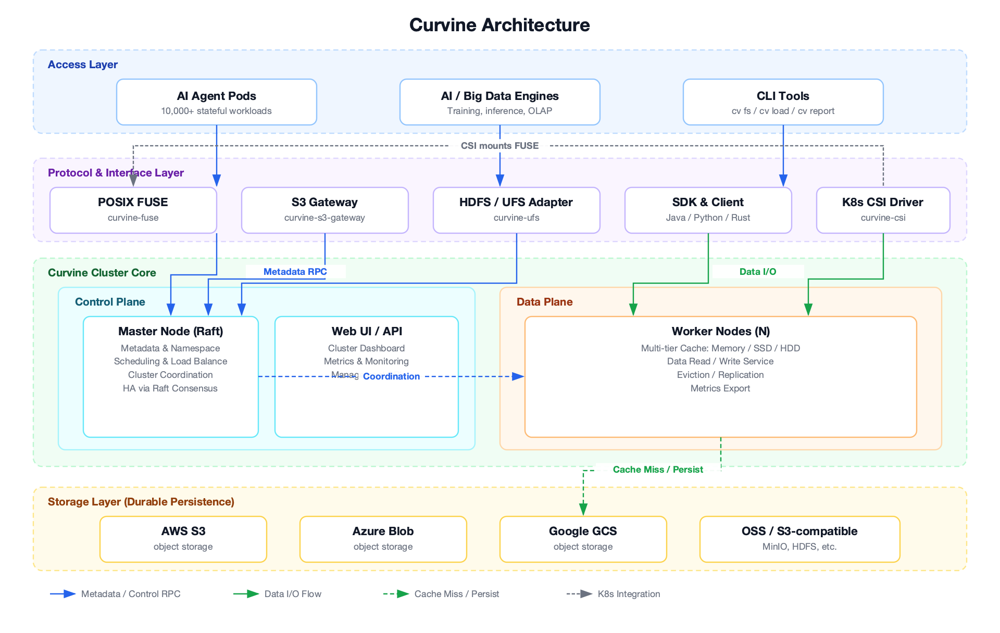

<div align=center>

</div>


<p align="center">
  <a href="https://github.com/CurvineIO/curvine/blob/main/README.md">English</a> |
  <a href="https://github.com/CurvineIO/curvine/blob/main/README_zh.md">简体中文</a> |
  Türkçe |
  <a href="https://readme-i18n.com/CurvineIO/curvine?lang=de">Deutsch</a> |
  <a href="https://readme-i18n.com/CurvineIO/curvine?lang=es">Español</a> |
  <a href="https://readme-i18n.com/CurvineIO/curvine?lang=fr">français</a> |
  <a href="https://readme-i18n.com/CurvineIO/curvine?lang=ja">日本語</a> |
  <a href="https://readme-i18n.com/CurvineIO/curvine?lang=ko">한국어</a> |
  <a href="https://readme-i18n.com/CurvineIO/curvine?lang=pt">Português</a> |
  <a href="https://readme-i18n.com/CurvineIO/curvine?lang=ru">Русский</a>
</p>

<p align="center">
  <a href="https://www.cncf.io/projects/curvine/"></a>
  <a href="https://landscape.cncf.io/?item=runtime--cloud-native-storage--curvine"></a>
  <a href="https://github.com/CurvineIO/curvine/releases"></a>
  <a href="https://opensource.org/licenses/Apache-2.0"></a>
  <a href="https://www.rust-lang.org"></a>
  <a href="https://scorecard.dev/viewer/?uri=github.com/CurvineIO/curvine"></a>
</p>

<p align="center">
  <a href="https://join.slack.com/t/curvineio/shared_invite/zt-4673r43cn-prajma_q5ZI3BUxuaY5kiQ"></a>
</p>

<p align="center">
  <b>Yapay zekâ odaklı, bulut yerel (cloud-native) dosya sistemi.</b><br>
  Nesne depolama üzerinde yerleşik çok katmanlı dağıtık önbelleğe sahip tam POSIX semantiği.<br>
  Yapay zekâ eğitimi, çıkarımı ve yapay zekâ ajan platformları için Rust ile geliştirildi.
</p>

<p align="center">
  <a href="#-hızlı-başlangıç">Hızlı Başlangıç</a> ·
  <a href="https://curvineio.github.io/docs/">Belgeler</a> ·
  <a href="#-performans">Kıyaslamalar</a> ·
  <a href="#-topluluk">Topluluk</a>
</p>

---

## ✨ Neden Curvine

Nesne depolama ucuz ve dayanıklıdır, ancak yapay zekâ iş yükleri hızlı bir yerel dosya sistemi bekler. Curvine ikisinin arasında yer alır: verileriniz S3'te (veya uyumlu herhangi bir depoda) kalır ve uygulamalarınız bellek, SSD ve HDD önbelleğiyle desteklenen bir POSIX dosya sistemi görür.

- **GPU'lar için yeterince hızlı.** Aynı AWS bulut sunucusu türleri üzerinde yapılan bir [MLPerf Storage v2.0 karşılaştırmasında](https://curvineio.github.io/blog/2026/09/07/mlperf-storage-curvine-vs-alluxio), açık kaynaklı Curvine hızlandırıcı kullanımında 8 çalıştırmanın 6'sında Alluxio Enterprise AI'ın gönderilen sonuçlarını geride bıraktı.
- **Gerçek POSIX uyumluluğu.** FUSE bağlaması [1.129 Linux Test Project (LTP) dosya sistemi testini sıfır hatayla geçti](https://curvineio.github.io/blog/2026/08/11/curvine-ltp-compatibility), böylece `git`, Vite ve `inotify` gibi araçlar değişiklik yapılmadan çalışır.
- **Ölçekli ajanlar için tasarlandı.** Tek bir küme 5 milyar dosya barındırır. Kubernetes'te yeni bir birim yalnızca bir `mkdir` işlemidir; bu sayede birim başına bulut API çağrıları olmadan [EKS üzerinde 10.000'den fazla durum bilgili (stateful) ajan pod'u çalıştırabilirsiniz](https://curvineio.github.io/blog/2026/07/07/ai-agent-storage-curvine-eks).
- **LLM çıkarımıyla kanıtlanmış.** AWS, [Curvine ile Amazon SageMaker HyperPod üzerinde katmanlı KV önbelleği](https://aws.amazon.com/blogs/machine-learning/tiered-kv-cache-for-large-llms-on-amazon-sagemaker-hyperpod-with-curvine/) için bir referans mimarisi yayımladı.
- **Bağımlılık yok (No lock-in).** Dosyalar S3'teki nesne yollarıyla 1:1 eşlenir. Demetinize (bucket) kalıcı olarak yazılan veriler, Curvine kapalıyken bile düz nesneler olarak okunabilir kalır.

## 🚀 Hızlı Başlangıç

### Docker ile deneyin

Tek bir komutla tek düğümlü bir demo kümesi (bir master, bir worker) başlatın:

```bash
curl -fsSL https://curvineio.github.io/install.sh | bash
```

Betik, Web arayüzü adresini ve konteynerleri incelemek ve kaldırmak için gereken komutları yazdırır.

### Kubernetes üzerinde dağıtın

```bash
helm repo add curvineio https://curvineio.github.io/helm-charts
helm repo update

# Curvine kümesi
helm upgrade --install curvine curvineio/curvine -n curvine --create-namespace

# Küme erişilebilir olduğunda CSI sürücüsü
helm upgrade --install curvine-csi curvineio/curvine-csi -n curvine-system --create-namespace
```

Yapılandırma için [Helm chart'larına](https://github.com/CurvineIO/curvine-helm) ve bir `StorageClass` oluşturmak için [CSI sürücü kılavuzuna](https://curvineio.github.io/docs/User-Manuals/K8S-CSI-Driver/) bakın.

### Kaynak koddan derleyin ve çalıştırın

`build/dist` içinde bir paket üretmek için [derleme talimatlarını](https://curvineio.github.io/docs/Deploy/build-instructions/) izleyin, ardından:

```bash
cd build/dist
export CURVINE_MASTER_HOSTNAME=localhost
./bin/curvine-master.sh start
./bin/curvine-worker.sh start
./bin/curvine-fuse.sh start   # /curvine-fuse konumuna bağlar

bin/cv report                 # küme durumunu kontrol et
bin/cv fs mkdir /hello
ls /curvine-fuse
```

Durdurmak için aynı betikleri ters sırayla `stop` parametresiyle çalıştırın: `curvine-fuse.sh`, `curvine-worker.sh`, ardından `curvine-master.sh`.

Web arayüzleri: master `http://<host>:9001`, worker `http://<host>:9002`.

[Hızlı Başlangıç kılavuzu](https://curvineio.github.io/docs/Deploy/quick-start/) her adımı ayrıntılı olarak ele alır.

## 📈 Kullanım Senaryoları


| Kullanım senaryosu | Curvine ne yapar |
| --- | --- |
| **Yapay zekâ ajan platformu depolaması** | On binlerce durum bilgili ajan pod'una, düğüm başına birim sınırı olmadan milisaniyeler içinde sağlanan kendi POSIX çalışma alanlarını verir. |
| **LLM eğitimi** | Eğitimin G/Ç bekleyerek daha az zaman harcaması için veri kümelerini ve kontrol noktalarını (checkpoint) GPU düğümlerinin yanında önbelleğe alır. |
| **Model dağıtımı** | Model ağırlıklarını her düğümde nesne depolamadan çekmek yerine önbellek aracılığıyla bölgeler arasında dağıtır. |
| **Çok modlu (Multimodal) veri gölleri** | Görüntüleri, videoları ve Lance veri kümelerini yerel diske kopyalamadan POSIX üzerinden sunar. |
| **OLAP hızlandırma** | StarRocks gibi hesaplama-depolama ayrılmış motorlar için sıcak verileri önbelleğe alır. |
| **Çoklu bulut önbellekleme** | Farklı bulut sağlayıcılarının nesne depolama alanlarının önüne tek bir önbellek katmanı koyar. |

<details>
<summary><b>Her kullanım senaryosunu iş başında görün</b></summary>

**Yapay zekâ ajan platformu depolaması**


**LLM eğitimi**


**Model dağıtımı**


**Çok modlu veri gölleri**


**OLAP hızlandırma**


**Çoklu bulut önbellekleme**


</details>

## 🏗️ Mimari



Curvine, yukarıdaki diyagramda renk kodlu olarak gösterilen dört katmana sahiptir:

- **Erişim katmanı.** Üstteki iş yükleri: yapay zekâ ajan pod'ları, eğitim ve çıkarım işleri, OLAP ve büyük veri motorları ve `cv` CLI.
- **Protokol katmanı.** Mevcut araçlar kod değişikliği olmadan POSIX (FUSE), S3 uyumlu ağ geçidi, Hadoop FileSystem API, Java/Python/Rust SDK'ları veya Kubernetes CSI sürücüsü aracılığıyla bağlanır.
- **Küme çekirdeği.**
  - *Kontrol düzlemi (control plane)*, meta verilerin, ad alanının, zamanlamanın ve küme koordinasyonunun sahibi olan Raft ile çoğaltılmış bir **master**'dır. Ayrıca Web arayüzünü ve metrikleri sunar.
  - *Veri düzlemi (data plane)*, sıcak verileri otomatik olarak yükselterek ve soğuk verileri çıkararak bellek → SSD → HDD önbelleğinden veri sunan bir **worker** kümesidir.
- **Depolama katmanı.** Kalıcı kopyayı nesne depolama tutar: AWS S3, Azure Blob Storage, Google Cloud Storage, Alibaba Cloud OSS, MinIO, S3 uyumlu herhangi bir başka depo veya HDFS.

Meta veri istekleri RPC üzerinden master'a gider. Veri doğrudan istemciler ve worker'lar arasında akar. Önbellek ıskalamasında (cache miss) worker'lar nesne depolamadan okur ve yazma işlemleri oraya kalıcı olarak aktarılır. Kubernetes'te CSI sürücüsü FUSE bağlamasını bir PVC olarak sunar, bu nedenle bir birim oluşturmak yalnızca bir dizin oluşturur ve milisaniyeler sürer.

## 🧩 Özellikler

| Alan | Ayrıntılar |
| --- | --- |
| **Erişim** | FUSE üzerinden POSIX (`open`, `read`, `write`, `seek`, `rename`, `list`), S3 ağ geçidi, Hadoop FileSystem API, Java/Python/Rust SDK'ları |
| **Kubernetes** | Dinamik sağlama ve `Immediate` bağlama özellikli CSI sürücüsü; küme için Helm chart'ları |
| **Depolama arka uçları** | AWS S3, Azure Blob Storage, Google Cloud Storage, Alibaba Cloud OSS, MinIO ve S3 uyumlu diğer depolar, HDFS |
| **Önbellekleme** | Bellek → SSD → HDD katmanları, otomatik sıcak veri yükseltme, çıkarma (eviction) ve çoğaltma |
| **Performans** | Rust ve Tokio eşzamansız G/Ç, sıfır kopyalama (zero-copy) veri yolları, çöp toplayıcı yok; yaklaşık 100 µs gecikme ve sürekli 100K+ QPS |
| **Ölçek** | Tek bir kümede 5 milyara kadar dosya |
| **Güvenilirlik** | Raft ile çoğaltılmış meta veriler; dosyalar nesne yollarıyla 1:1 eşlenir, böylece veriler doğrudan nesne depolamadan okunabilir kalır |
| **Gözlemlenebilirlik** | Her bileşen için yerleşik metrikler ve Web arayüzü |

## 📊 Performans

### Meta veri işlemleri

40 eşzamanlı istemci. JuiceFS ve OSS değerleri [JuiceFS'nin yayımlanan kıyaslamasından](https://juicefs.com/en/blog/engineering/meta-perf-hdfs-oss-jfs) alınmıştır.

| İşlem | Curvine (QPS) | JuiceFS (QPS) | OSS (QPS) |
| --- | --- | --- | --- |
| create | 19.985 | 16.000 | 2.000 |
| open | 60.376 | 50.000 | 3.900 |
| rename | 43.009 | 21.000 | 200 |
| delete | 39.013 | 41.000 | 1.900 |

### Okuma aktarım hızı: Curvine ve Alluxio

Aynı donanım üzerinde 256 KB okumalar. Alluxio değerleri [Alluxio'nun kendi yayımlanan karşılaştırmasından](https://www.alluxio.com.cn/alluxio-enterprise-vs-open-source/) alınmıştır. "N/A", Alluxio'nun o iş parçacığı sayısı için bir sonuç yayımlamadığı anlamına gelir.

| İş Parçacığı | Sıralı: Curvine (GiB/s) | Sıralı: Alluxio OSS (GiB/s) | Rastgele: Curvine (GiB/s) | Rastgele: Alluxio OSS (GiB/s) |
| --- | --- | --- | --- | --- |
| 1 | 2,2 | 0,6 | 0,3 | 0,0 |
| 2 | 3,7 | 1,1 | 0,7 | 0,1 |
| 4 | 6,8 | 2,3 | 1,4 | 0,1 |
| 8 | 8,9 | 4,5 | 2,8 | 0,2 |
| 16 | 9,2 | 7,9 | 5,2 | 0,4 |
| 32 | 9,5 | 8,8 | 7,8 | 0,3 |
| 64 | 9,2 | N/A | 8,7 | N/A |
| 128 | 9,2 | N/A | 9,0 | N/A |

### Kaynak kullanımı

Üretim büyük veri karıştırma (shuffle) iş yüklerinde Curvine, Alluxio'ya kıyasla %90'dan fazla daha az bellek ve %50'den fazla daha az CPU kullandı.

FIO ve küçük dosya okumaları dahil daha fazla sonuç [kıyaslama belgelerinde](https://curvineio.github.io/docs/Benchmark/) yer almaktadır.

## 📚 Daha Fazla Bilgi

- [Belgeler](https://curvineio.github.io/docs/)
- [Mimari derinlemesine incelemeleri](https://curvineio.github.io/docs/Architecture/)
- [En iyi uygulamalar](https://curvineio.github.io/docs/User-Manuals/best-practices/)
- [DeepWiki: kod tabanı hakkında sorular sorun](https://deepwiki.com/CurvineIO/curvine)
- [Blog](https://curvineio.github.io/blog)

## 💬 Topluluk

- **Sohbet:** [Slack](https://join.slack.com/t/curvineio/shared_invite/zt-4673r43cn-prajma_q5ZI3BUxuaY5kiQ) veya [Discord](https://discord.gg/xfxMQKv3)
- **Sorular ve fikirler:** [GitHub Discussions](https://github.com/CurvineIO/curvine/discussions)
- **Hatalar ve özellik istekleri:** [GitHub Issues](https://github.com/CurvineIO/curvine/issues)
- **Curvine kullanıyor musunuz?** Şirketinizi [ADOPTERS.md](ADOPTERS.md) dosyasına ekleyin.
- **Proje yönü:** [yol haritası](ROADMAP.md) ve [yönetişim](GOVERNANCE.md) belgelerine bakın.

## 🤝 Katkıda Bulunma

Katkılarınızı bekliyoruz. Başlamak için [katkıda bulunma kılavuzunu](CONTRIBUTING.md) okuyun ve [`good first issue`](https://github.com/CurvineIO/curvine/labels/good%20first%20issue) etiketli konulara göz atın.

<a href="https://github.com/CurvineIO/curvine/graphs/contributors">
  
</a>

[contrib.rocks](https://contrib.rocks/) ile oluşturuldu.

## 🪐 Adın Hikayesi

"Curvine", Liu Cixin'in bilim kurgu romanı *Üç Cisim Problemi*'ndeki ışıktan hızlı motor olan *eğrilik motorundan* (*curvature engine*) gelmektedir. Projeyi veri erişimini olabildiğince hızlı hale getirmek için seçtik.

## ☁️ CNCF

Curvine bir [Cloud Native Computing Foundation](https://www.cncf.io/) sandbox projesidir.

<p align="center">
  
</p>

## 📜 Lisans

Curvine [Apache License 2.0](LICENSE) altında lisanslanmıştır.
