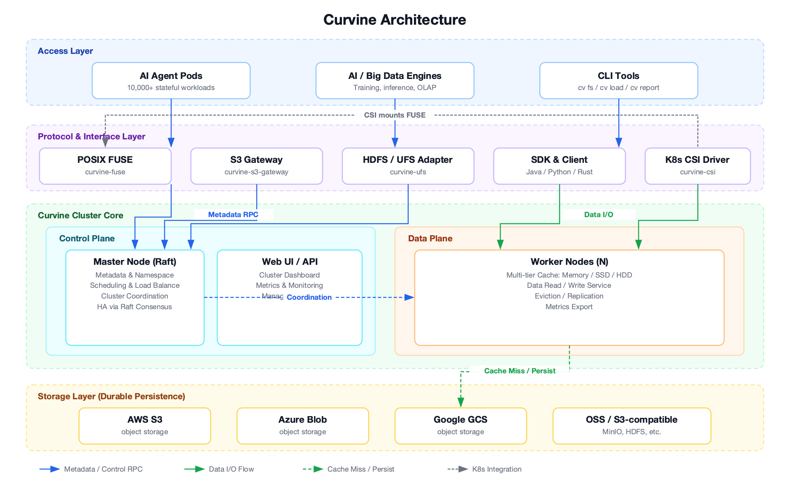

<div align=center>

</div>


<p align="center">
  <a href="https://github.com/CurvineIO/curvine/blob/main/README.md">English</a> |
  简体中文 |
  <a href="https://readme-i18n.com/CurvineIO/curvine?lang=de">Deutsch</a> |
  <a href="https://readme-i18n.com/CurvineIO/curvine?lang=es">Español</a> |
  <a href="https://readme-i18n.com/CurvineIO/curvine?lang=fr">français</a> |
  <a href="https://readme-i18n.com/CurvineIO/curvine?lang=ja">日本語</a> |
  <a href="https://readme-i18n.com/CurvineIO/curvine?lang=ko">한국어</a> |
  <a href="https://readme-i18n.com/CurvineIO/curvine?lang=pt">Português</a> |
  <a href="https://readme-i18n.com/CurvineIO/curvine?lang=ru">Русский</a>
</p>

<p align="center">
  <a href="https://www.cncf.io/projects/curvine/"></a>
  <a href="https://landscape.cncf.io/?item=runtime--cloud-native-storage--curvine"></a>
  <a href="https://github.com/CurvineIO/curvine/releases"></a>
  <a href="https://opensource.org/licenses/Apache-2.0"></a>
  <a href="https://www.rust-lang.org"></a>
  <a href="https://scorecard.dev/viewer/?uri=github.com/CurvineIO/curvine"></a>
</p>

<p align="center">
  <a href="https://join.slack.com/t/curvineio/shared_invite/zt-4673r43cn-prajma_q5ZI3BUxuaY5kiQ"></a>
</p>

<p align="center">
  <b>AI 原生、云原生的文件系统。</b><br>
  在对象存储之上提供完整的 POSIX 语义，内置多级分布式缓存。<br>
  使用 Rust 构建，面向 AI 训练、推理和 AI Agent 平台。
</p>

<p align="center">
  <a href="#-快速开始">快速开始</a> ·
  <a href="https://curvineio.github.io/zh-cn/docs/">文档</a> ·
  <a href="#-性能">性能测试</a> ·
  <a href="#-社区">社区</a>
</p>

---

## ✨ 为什么选择 Curvine

对象存储便宜、可靠，但 AI 负载需要的是一个快速的本地文件系统。Curvine 位于两者之间：数据仍然存放在 S3（或任何兼容的对象存储）中，应用看到的是一个由内存、SSD、HDD 多级缓存加速的 POSIX 文件系统。

- **跟得上 GPU。** 在[MLPerf Storage v2.0 对比测试](https://curvineio.github.io/zh-cn/blog/2026/09/07/mlperf-storage-curvine-vs-alluxio)中，使用同类 AWS 机型，开源版 Curvine 在 8 组测试中有 6 组的加速器利用率超过 Alluxio Enterprise AI 提交的官方成绩。
- **真正的 POSIX 兼容。** FUSE 挂载[通过了 Linux Test Project（LTP）1,129 项文件系统测试，零失败](https://curvineio.github.io/zh-cn/blog/2026/08/11/curvine-ltp-compatibility)，`git`、Vite、`inotify` 等工具无需修改即可使用。
- **为大规模 Agent 而设计。** 单集群可容纳 50 亿个文件。在 Kubernetes 上创建一个卷只需一次 `mkdir`，因此可以[在 EKS 上运行上万个有状态 Agent Pod](https://curvineio.github.io/zh-cn/blog/2026/07/07/ai-agent-storage-curvine-eks)，无需为每个卷调用云厂商 API。
- **经过 LLM 推理验证。** AWS 发布了[基于 Curvine 在 Amazon SageMaker HyperPod 上实现分层 KV Cache](https://aws.amazon.com/cn/blogs/machine-learning/tiered-kv-cache-for-large-llms-on-amazon-sagemaker-hyperpod-with-curvine/) 的参考架构。
- **不绑定厂商。** 文件与 S3 中的对象路径一一对应。已持久化到存储桶的数据始终是普通对象，即使 Curvine 不可用也能直接读取。

## 🚀 快速开始

### 用 Docker 体验

一条命令启动单节点演示集群（一个 master、一个 worker）：

```bash
curl -fsSL https://curvineio.github.io/install.sh | bash
```

脚本会输出 Web UI 地址，以及查看和删除容器的命令。

### 部署到 Kubernetes

```bash
helm repo add curvineio https://curvineio.github.io/helm-charts
helm repo update

# Curvine 集群
helm upgrade --install curvine curvineio/curvine -n curvine --create-namespace

# CSI 驱动，在集群可访问后安装
helm upgrade --install curvine-csi curvineio/curvine-csi -n curvine-system --create-namespace
```

配置项见 [Helm charts](https://github.com/CurvineIO/curvine-helm)，创建 `StorageClass` 见 [CSI 驱动指南](https://curvineio.github.io/zh-cn/docs/User-Manuals/K8S-CSI-Driver/)。

### 从源码编译运行

按照[编译指南](https://curvineio.github.io/zh-cn/docs/Deploy/build-instructions/)在 `build/dist` 下生成安装包，然后执行：

```bash
cd build/dist
export CURVINE_MASTER_HOSTNAME=localhost
./bin/curvine-master.sh start
./bin/curvine-worker.sh start
./bin/curvine-fuse.sh start   # 挂载在 /curvine-fuse

bin/cv report                 # 查看集群状态
bin/cv fs mkdir /hello
ls /curvine-fuse
```

停止时按相反顺序用 `stop` 参数执行这些脚本：先 `curvine-fuse.sh`，再 `curvine-worker.sh`，最后 `curvine-master.sh`。

Web UI：master 位于 `http://<host>:9001`，worker 位于 `http://<host>:9002`。

每一步的详细说明见[快速开始文档](https://curvineio.github.io/zh-cn/docs/Deploy/quick-start/)。

## 📈 应用场景


| 场景 | Curvine 的作用 |
| --- | --- |
| **AI Agent 平台存储** | 为上万个有状态 Agent Pod 提供各自独立的 POSIX 工作空间，毫秒级创建，不受单节点卷数量限制。 |
| **LLM 训练** | 在 GPU 节点旁缓存数据集和 checkpoint，减少训练等待 I/O 的时间。 |
| **模型分发** | 通过缓存在多个地域间分发模型权重，避免每个节点都从对象存储拉取。 |
| **多模态数据湖** | 通过 POSIX 直接访问图片、视频和 Lance 数据集，无需复制到本地磁盘。 |
| **OLAP 加速** | 为 StarRocks 等存算分离引擎缓存热数据。 |
| **多云缓存** | 在不同云厂商的对象存储之前提供统一的缓存层。 |

<details>
<summary><b>查看各场景演示</b></summary>

**AI Agent 平台存储**


**LLM 训练**


**模型分发**


**多模态数据湖**


**OLAP 加速**


**多云缓存**


</details>

## 🏗️ 架构



Curvine 分为四层，在上图中以不同颜色区分：

- **接入层。** 上层负载：AI Agent Pod、训练和推理任务、OLAP 与大数据引擎，以及 `cv` 命令行工具。
- **协议层。** 现有工具无需改代码即可接入，支持 POSIX（FUSE）、S3 兼容网关、Hadoop FileSystem API、Java/Python/Rust SDK 和 Kubernetes CSI 驱动。
- **集群核心。**
  - *控制面*是一组通过 Raft 复制的 **master**，负责元数据、命名空间、调度和集群协调，同时提供 Web UI 和监控指标。
  - *数据面*由多个 **worker** 组成，从内存 → SSD → HDD 多级缓存中提供数据，自动提升热数据、淘汰冷数据。
- **存储层。** 对象存储保存持久化副本，支持 AWS S3、Azure Blob Storage、Google Cloud Storage、阿里云 OSS、MinIO 及其他 S3 兼容存储，以及 HDFS。

元数据请求通过 RPC 发往 master，数据在客户端和 worker 之间直接传输。缓存未命中时，worker 从对象存储读取数据，写入的数据也会持久化回对象存储。在 Kubernetes 上，CSI 驱动把 FUSE 挂载点以 PVC 的形式提供给 Pod，创建卷只是创建一个目录，耗时在毫秒级。

## 🧩 功能特性

| 方面 | 说明 |
| --- | --- |
| **访问方式** | 通过 FUSE 提供 POSIX 接口（`open`、`read`、`write`、`seek`、`rename`、`list`），S3 网关，Hadoop FileSystem API，Java/Python/Rust SDK |
| **Kubernetes** | CSI 驱动支持动态创建卷、`Immediate` 绑定和卷扩容；提供集群 Helm charts |
| **存储后端** | AWS S3、Azure Blob Storage、Google Cloud Storage、阿里云 OSS、MinIO 及其他 S3 兼容存储、HDFS |
| **缓存** | 内存 → SSD → HDD 多级缓存，自动提升热数据、淘汰和多副本 |
| **性能** | Rust + Tokio 异步 I/O，零拷贝数据路径，无垃圾回收；延迟约 100 µs，稳定支撑 10 万以上 QPS |
| **规模** | 单集群最多 50 亿个文件 |
| **可靠性** | 元数据通过 Raft 复制；文件与对象路径一一对应，可直接从对象存储读取数据 |
| **可观测性** | 每个组件都内置监控指标和 Web UI |

## 📊 性能

### 元数据操作

40 并发。JuiceFS 和 OSS 的数据来自 [JuiceFS 公开的测试结果](https://juicefs.com/zh-cn/blog/engineering/meta-perf-hdfs-oss-jfs)。

| 操作 | Curvine (QPS) | JuiceFS (QPS) | OSS (QPS) |
| --- | --- | --- | --- |
| create | 19,985 | 16,000 | 2,000 |
| open | 60,376 | 50,000 | 3,900 |
| rename | 43,009 | 21,000 | 200 |
| delete | 39,013 | 41,000 | 1,900 |

### 读吞吐对比 Alluxio

相同硬件下的 256 KB 读测试。Alluxio 的数据来自 [Alluxio 官方公布的对比](https://www.alluxio.com.cn/alluxio-enterprise-vs-open-source/)。"N/A" 表示 Alluxio 未公布该线程数下的结果。

| 线程数 | 顺序读：Curvine (GiB/s) | 顺序读：Alluxio 开源版 (GiB/s) | 随机读：Curvine (GiB/s) | 随机读：Alluxio 开源版 (GiB/s) |
| --- | --- | --- | --- | --- |
| 1 | 2.2 | 0.6 | 0.3 | 0.0 |
| 2 | 3.7 | 1.1 | 0.7 | 0.1 |
| 4 | 6.8 | 2.3 | 1.4 | 0.1 |
| 8 | 8.9 | 4.5 | 2.8 | 0.2 |
| 16 | 9.2 | 7.9 | 5.2 | 0.4 |
| 32 | 9.5 | 8.8 | 7.8 | 0.3 |
| 64 | 9.2 | N/A | 8.7 | N/A |
| 128 | 9.2 | N/A | 9.0 | N/A |

### 资源消耗

在生产环境的大数据 shuffle 场景中，Curvine 的内存占用比 Alluxio 低 90% 以上，CPU 占用低 50% 以上。

更多结果（包括 FIO 和小文件读取）见[性能测试文档](https://curvineio.github.io/zh-cn/docs/Benchmark/)。

## 📚 了解更多

- [文档](https://curvineio.github.io/zh-cn/docs/)
- [架构详解](https://curvineio.github.io/zh-cn/docs/Architecture/)
- [最佳实践](https://curvineio.github.io/zh-cn/docs/User-Manuals/best-practices/)
- [DeepWiki：向代码库提问](https://deepwiki.com/CurvineIO/curvine)
- [博客](https://curvineio.github.io/zh-cn/blog)

## 💬 社区

- **交流：** [Slack](https://join.slack.com/t/curvineio/shared_invite/zt-4673r43cn-prajma_q5ZI3BUxuaY5kiQ) 或 [Discord](https://discord.gg/xfxMQKv3)
- **问题与想法：** [GitHub Discussions](https://github.com/CurvineIO/curvine/discussions)
- **Bug 与功能需求：** [GitHub Issues](https://github.com/CurvineIO/curvine/issues)
- **正在使用 Curvine？** 欢迎把你的公司加入 [ADOPTERS.md](ADOPTERS.md)。
- **项目方向：** 见 [路线图](ROADMAP.md) 和 [治理规则](GOVERNANCE.md)。

## 🤝 参与贡献

欢迎参与贡献。请先阅读[贡献指南](CONTRIBUTING.md)，可以从标记为 [`good first issue`](https://github.com/CurvineIO/curvine/labels/good%20first%20issue) 的 issue 开始。

<a href="https://github.com/CurvineIO/curvine/graphs/contributors">
  
</a>

由 [contrib.rocks](https://contrib.rocks/) 生成。

## 🪐 名字由来

"Curvine" 取自刘慈欣科幻小说《三体》中的"曲率驱动"（curvature engine），一种超光速推进装置。我们用这个名字，代表项目对极致数据访问速度的追求。

## ☁️ CNCF

Curvine 是[云原生计算基金会（CNCF）](https://www.cncf.io/)的 Sandbox 项目。

<p align="center">
  
</p>

## 📜 许可证

Curvine 采用 [Apache License 2.0](LICENSE) 开源协议。
