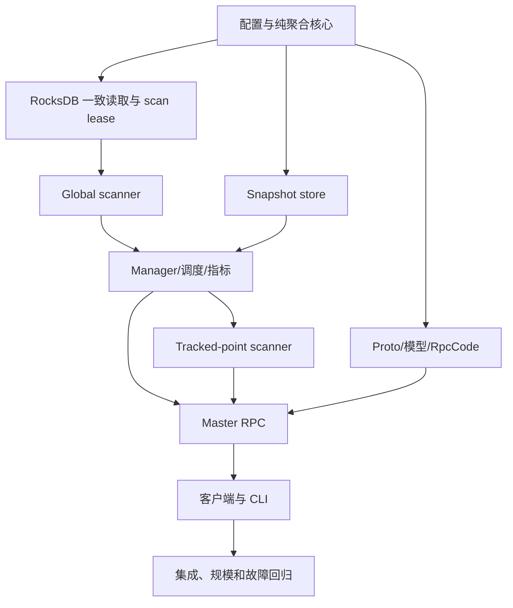

# Dir-Space Implementation Plan

> **For agentic workers:** REQUIRED SUB-SKILL: Use
> `superpowers:subagent-driven-development` (recommended) or
> `superpowers:executing-plans` to implement this plan task-by-task. Steps use checkbox
> (`- [ ]`) syntax for tracking.

**Goal:** 为 `curvine fs du` / `curvine fs count` 提供最终一致、资源有界、可观测的
master 端目录空间快照，同时保留 live 递归回退。

**Architecture:** active master 在同一个 RocksDB snapshot 上扫描 inode/edge，通过纯内存
聚合器生成不可变 generation；完整构建后在短写锁内原子替换。低频 global snapshot
覆盖全 namespace，高频 tracked-point snapshot 覆盖 mount 和配置路径。RPC 查询只做
路径解析、快照选择和 HashMap lookup。

**Tech Stack:** Rust、RocksDB snapshot/iterator、Curvine RPC/proto2、
`ScheduledExecutor`/`LoopTask`、Prometheus metrics、Clap CLI。

## Global Constraints

- 基线必须是最新 `origin/main-next`。
- 实施前必须创建并绑定新的 CoMind 父 Issue；历史 GitHub #224/#285 仅作追溯。
- 每个任务对应一个独立 commit，并在进入下一任务前保持 workspace 可编译、测试通过。
- 先写失败测试，再实现最小代码，再运行目标测试。
- 不新增第三方依赖；快照发布使用现有 `parking_lot::RwLock<Arc<T>>`。
- 不改变 journal/checkpoint 持久化格式和生成内容，也不修改 inode 格式或元数据写
  路径；允许修改 restore 并发协调。
- 所有新增 proto 字段使用新的 field number 和 `optional`；RpcCode 使用空闲值 `68`。
- 默认 `master.dir_space_enabled=false`。
- 扫描不得持有 `fs_dir` 全局读锁；仅查询/解析 tracked path 时允许短时持锁。
- 超时、达到限制、角色丢失或扫描失败不得发布部分结果。
- commit subject 使用英文；内部提交按实施时创建的 CoMind Issue 规则加 KEY/Issue ID。

---

## 1. 文件结构

### 新文件

| 文件 | 单一职责 |
| --- | --- |
| `curvine-master/src/master/space/mod.rs` | space 模块导出 |
| `curvine-master/src/master/space/types.rs` | 聚合、快照、查询结果、扫描终止原因 |
| `curvine-master/src/master/space/agg.rs` | 纯内存树聚合 |
| `curvine-master/src/master/space/scan_lease.rs` | 扫描与 Raft restore 的取消/等待协调 |
| `curvine-master/src/master/space/scanner.rs` | RocksDB snapshot 的 global/point 扫描 |
| `curvine-master/src/master/space/store.rs` | immutable generation 发布和选择 |
| `curvine-master/src/master/space/manager.rs` | 路径解析、扫描编排、查询 API |
| `curvine-master/src/master/space/scheduler.rs` | 单一 active-only coordinator |
| `crates/common/curvine-model/src/content_summary.rs` | 客户端共享返回模型 |

### 修改文件

| 文件 | 变更 |
| --- | --- |
| `crates/common/curvine-config/src/master_conf.rs` | Dir-Space 配置、默认值和校验 |
| `crates/adapters/curvine-rocksdb/src/rocksdb/db_engine.rs` | 同一 DB snapshot 的 CF iterator |
| `crates/adapters/curvine-rocksdb/src/lib.rs` | snapshot reader 类型的受控导出 |
| `crates/common/curvine-error/src/fs_error.rs` | `SnapshotNotReady` wire error |
| `curvine-master/src/master/meta/store/rocks_inode_store.rs` | inode/edge snapshot scan 包装 |
| `curvine-master/src/master/meta/store/inode_store.rs` | scan lease 与 restore 协调 |
| `curvine-master/src/master/meta/fs_dir.rs` | 在清空内存树前获取 restore guard |
| `curvine-master/src/master/mod.rs` | 导出 `space` |
| `curvine-master/src/master/fs/master_actor.rs` | 启动 scheduler |
| `curvine-master/src/master/master_server.rs` | 构建并共享 manager |
| `curvine-master/src/master/master_metrics.rs` | 扫描与快照 metrics |
| `crates/common/curvine-proto/proto/master.proto` | content summary RPC message |
| `crates/common/curvine-fs-api/src/rpc_code.rs` | `GetContentSummary = 68` 与 capability |
| `crates/common/curvine-model/src/lib.rs` | 导出共享模型 |
| `crates/common/curvine-model/src/proto_utils.rs` | proto/model 转换 |
| `curvine-master/src/master/master_handler.rs` | RPC handler 与 dispatch |
| `crates/client/curvine-client-core/src/file/fs_client.rs` | 底层 RPC |
| `crates/client/curvine-client-core/src/file/curvine_filesystem.rs` | Curvine client facade |
| `crates/client/curvine-unified-fs/src/unified/unified_filesystem.rs` | Unified facade 与能力判断 |
| `curvine-cli/src/cmds/fs/common.rs` | snapshot/live 两条 summary 路径 |
| `curvine-cli/src/cmds/fs/commands.rs` | `--live` 参数 |
| `curvine-cli/src/cmds/fs/du.rs` | snapshot 输出与回退 |
| `curvine-cli/src/cmds/fs/count.rs` | snapshot 输出与回退 |

---

## 2. 依赖图



---

## Task 1: 配置与纯聚合核心

**Files:**

- Create: `curvine-master/src/master/space/mod.rs`
- Create: `curvine-master/src/master/space/types.rs`
- Create: `curvine-master/src/master/space/agg.rs`
- Modify: `curvine-master/src/master/mod.rs`
- Modify: `crates/common/curvine-config/src/master_conf.rs`

**Interfaces:**

- Produces:
  - `DirAgg::add_file(len) -> CommonResult<()>`
  - `DirAgg::merge(&DirAgg) -> CommonResult<()>`
  - `SubtreeAggregator::new(root, max_dirs, max_depth)`
  - `add_dir(id, parent_id)` / `add_file(parent_id, len)`
  - `build() -> CommonResult<AggregationOutput>`
  - `MasterConf::dir_space_global_scan_interval_ms()` 等 duration accessor

- [ ] **Step 1: 写配置失败测试**

在 `master_conf.rs` 增加测试，覆盖默认关闭、所有默认值、零上限、非法 duration、
timeout 大于 global interval、相对 tracked path 和路径去重。断言具体错误中包含配置名。

- [ ] **Step 2: 运行配置测试并确认失败**

```bash
cargo test -p curvine-config master_conf::tests::dir_space -- --nocapture
```

Expected: FAIL，原因是 `MasterConf` 尚无 `dir_space_*` 字段。

- [ ] **Step 3: 增加配置字段、默认值、解析和校验**

严格采用设计文档第 10 节的字段与默认值。duration 在 `init()` 中解析到
`DurationUnit`；tracked paths 规范化、拒绝相对路径、去重并去掉 `/`。

- [ ] **Step 4: 写聚合器失败测试**

从 `b83fbd61` 重新引入并更新测试，至少覆盖：

- 空根目录
- 宽树和 500 层深树
- 文件长度和文件数
- hard-link edge 在两个目录分别计数
- orphan、self edge 和 cycle
- `max_dirs`、`max_depth`
- `u64` bytes/files/dirs 溢出

测试必须比较迭代聚合结果与小规模递归 baseline。

- [ ] **Step 5: 运行聚合器测试并确认失败**

```bash
cargo test -p curvine-master master::space::agg::tests -- --nocapture
```

Expected: FAIL，原因是 `space` 模块或聚合类型尚不存在。

- [ ] **Step 6: 实现紧凑类型和迭代聚合器**

实现 checked arithmetic；不可达节点不进入结果。self edge、cycle 和 orphan 记录到
`AggregationStats`，上限/溢出返回结构化 `ScanAbortReason`。

- [ ] **Step 7: 验证 Task 1**

```bash
cargo test -p curvine-config master_conf::tests::dir_space
cargo test -p curvine-master master::space::agg::tests
cargo check -p curvine-master
```

Expected: 全部 PASS。

- [ ] **Step 8: 提交**

```bash
git add crates/common/curvine-config/src/master_conf.rs \
  curvine-master/src/master/mod.rs curvine-master/src/master/space
git commit -m "feat(master): add dir-space aggregation core"
```

---

## Task 2: RocksDB 同代一致读取与 restore-safe scan lease

**Files:**

- Modify: `crates/adapters/curvine-rocksdb/src/rocksdb/db_engine.rs`
- Modify: `crates/adapters/curvine-rocksdb/src/lib.rs`
- Modify: `curvine-master/src/master/meta/store/rocks_inode_store.rs`
- Modify: `curvine-master/src/master/meta/store/inode_store.rs`
- Modify: `curvine-master/src/master/meta/fs_dir.rs`
- Create: `curvine-master/src/master/space/scan_lease.rs`
- Test: corresponding `#[cfg(test)]` modules

**Interfaces:**

- Produces:
  - `DBEngine::read_snapshot() -> DbReadSnapshot<'_>`（adapter 内部 wrapper，不向上层泄漏
    rocksdb 具体类型）
  - `DbReadSnapshot::bulk_scan(cf)` / `get_cf(cf, key)` / `prefix_scan(cf, prefix)`
  - `InodeStore::begin_snapshot_scan() -> CommonResult<MetadataScanLease>`
  - `MetadataScanLease::snapshot_reader() -> CommonResult<InodeStoreSnapshot<'_>>`
  - `MetadataScanLease::is_cancelled() -> bool`
  - `InodeStoreSnapshot::scan_inodes()` / `scan_edges()`
  - point scan 所需 `get_inode(id)` 与 `scan_children(parent_id)`

- [ ] **Step 1: 写跨 CF snapshot 测试**

在临时 DB 创建 `inodes`/`edges`，获取 snapshot 后写入新 inode 和 edge；断言两个
snapshot iterator 均看不到后写入内容，普通 iterator 能看到。

- [ ] **Step 2: 运行测试并确认失败**

```bash
cargo test -p curvine-rocksdb snapshot_bulk_scan -- --nocapture
```

Expected: FAIL，snapshot iterator API 尚不存在。

- [ ] **Step 3: 实现 snapshot iterator**

使用 RocksDB `ReadOptions::set_snapshot`、`total_order_seek=true`、
`fill_cache=false`、64 MiB readahead。所有 iterator 生命周期不得超过 snapshot。

- [ ] **Step 4: 为 inode store 增加 typed wrapper 测试与实现**

wrapper 只暴露 Dir-Space 所需读接口，不暴露可写 DB。验证 snapshot 生命周期内
`scan_inodes`、`scan_edges`、`get_inode`、`scan_children` 返回同一代数据。

- [ ] **Step 5: 写 scan/restore 并发失败测试**

启动 scan lease 并创建 iterator；并发调用 `FsDir::restore`。断言 restore 设置取消
状态、scanner drop snapshot/iterator/lease 后 restore 成功；restore 等待超时发生在
`root_dir` 清空前，原 DB 和原内存 namespace 均仍可查询；restoring 期间新 lease 返回
busy。最后断言 `Arc::strong_count(&store)==1`。

- [ ] **Step 6: 实现 `MetadataScanControl`**

使用 `parking_lot::Mutex + Condvar` 维护 `active_leases`、`restoring`、`cancel_epoch`。
`InodeStore::new` 从 `MasterConf` 接收 restore wait timeout。lease Drop 递减并 notify；
`FsDir::restore` 首先获取 `MetadataRestoreGuard`，成功后才清空 root 并调用
`restore_with_guard`；guard 在成功/失败时清除 restoring。manager 不得持有永久 store
clone。

- [ ] **Step 7: 验证 Task 2**

```bash
cargo test -p curvine-rocksdb snapshot_bulk_scan
cargo test -p curvine-master snapshot_scanner
cargo test -p curvine-master scan_restore_coordination
cargo check -p curvine-master
```

Expected: 全部 PASS。

- [ ] **Step 8: 提交**

```bash
git add crates/adapters/curvine-rocksdb/src \
  curvine-master/src/master/meta/store \
  curvine-master/src/master/meta/fs_dir.rs \
  curvine-master/src/master/space/scan_lease.rs
git commit -m "feat(master): coordinate metadata snapshot scan leases"
```

---

## Task 3: Global scanner

**Files:**

- Create: `curvine-master/src/master/space/scanner.rs`
- Modify: `curvine-master/src/master/space/mod.rs`
- Test: `scanner.rs` unit/integration tests

**Interfaces:**

- Consumes: Task 1 aggregator、Task 2 `InodeStoreSnapshot`
- Produces:
  - `GlobalScanner::scan(&MetadataScanLease, &ScanContext) -> CommonResult<UnpublishedSnapshot>`
  - `ScanContext { deadline_ms, is_active, limits }`
  - `InodeFact { is_dir, logical_len }`（private）

- [ ] **Step 1: 写真实临时 RocksDB global scan 测试**

构造 root、两层目录、普通文件、硬链接和 symlink，断言 root 与每个目录的
`DirAgg`、`inode_count`、`edge_count`。

- [ ] **Step 2: 增加错误路径测试**

覆盖缺失 child inode、负长度、损坏 inode bytes、deadline、`max_inodes`、
`max_dirs`、`max_depth`、active callback 变 false 和 bytes 溢出。

- [ ] **Step 3: 运行测试并确认失败**

```bash
cargo test -p curvine-master master::space::scanner::tests::global -- --nocapture
```

Expected: FAIL，`GlobalScanner` 尚不存在。

- [ ] **Step 4: 实现 compact fact + 两 CF scan**

每 4096 条检查 cooperative deadline、role 和 lease cancellation。检查 inode、edge、
dir、depth、单 record bytes 与估算内存预算。inode 反序列化失败或资源上限返回 error；
缺失 edge 目标和负长度增加 anomaly。构建完成前不得创建可发布 snapshot，scanner
产物不携带 generation。

- [ ] **Step 5: 验证无 fs_dir 依赖**

scanner 的生产类型只能接收单轮 `&MetadataScanLease`/snapshot read handle，不得持有
`Arc<InodeStore>`、`MasterFilesystem` 或 `ArcRwLock<FsDir>`。在 code review 中检查
import 和字段。

- [ ] **Step 6: 验证 Task 3**

```bash
cargo test -p curvine-master master::space::scanner::tests
cargo check -p curvine-master
```

Expected: 全部 PASS。

- [ ] **Step 7: 提交**

```bash
git add curvine-master/src/master/space
git commit -m "feat(master): build global dir-space snapshots"
```

---

## Task 4: Snapshot store 与查询选择

**Files:**

- Create: `curvine-master/src/master/space/store.rs`
- Modify: `curvine-master/src/master/space/mod.rs`

**Interfaces:**

- Consumes: `UnpublishedSnapshot`
- Produces:
  - `DirSpaceSnapshotStore::publish_global(snapshot)`
  - `publish_point(root_id, path, snapshot)`
  - `remove_point(path)`
  - `query(dir_id, validated_point_path: Option<&str>) -> Result<DirSpaceQueryResult, SnapshotMiss>`
  - `global() -> Option<Arc<DirSpaceSnapshot>>`

- [ ] **Step 1: 写 store 并发失败测试**

一个 writer 连续发布 generation 1..100，多个 reader 循环查询；断言每次读取的
meta 与 entries 来自同一 generation，永不观察半成品。

- [ ] **Step 2: 写选择规则测试**

覆盖：无快照、global only、point generation 比 global 新/旧、同一路径 point 替换、
point 删除、失败轮后旧 generation 保留。

- [ ] **Step 3: 运行测试并确认失败**

```bash
cargo test -p curvine-master master::space::store::tests -- --nocapture
```

Expected: FAIL，store 尚不存在。

- [ ] **Step 4: 实现 store**

锁内分配 generation 并只替换/clone `Arc`。manager 负责 path/root 验证，store 只接受
已验证的 point path；若该 point 包含 query inode 且 generation 大于 global，则使用
point，否则 fallback global。global 也 miss 时返回 `SnapshotMiss`，禁止返回零值。

- [ ] **Step 5: 验证并提交**

```bash
cargo test -p curvine-master master::space::store::tests
cargo check -p curvine-master
git add curvine-master/src/master/space
git commit -m "feat(master): publish immutable dir-space generations"
```

---

## Task 5: Manager、active-only 调度与 metrics

**Files:**

- Create: `curvine-master/src/master/space/manager.rs`
- Create: `curvine-master/src/master/space/scheduler.rs`
- Modify: `curvine-master/src/master/space/mod.rs`
- Modify: `curvine-master/src/master/fs/master_actor.rs`
- Modify: `curvine-master/src/master/master_server.rs`
- Modify: `curvine-master/src/master/master_metrics.rs`

**Interfaces:**

- Consumes: global scanner、snapshot store、`MasterMonitor`
- Produces:
  - `DirSpaceManager::new(fs, mount_manager, monitor, conf, metrics)`
  - `try_scan_global() -> ScanOutcome`
  - `query(path) -> Result<DirSpaceQueryResult, DirSpaceQueryError>`，其中内部错误包含
    `Disabled`、`SnapshotMiss` 和底层路径错误；Task 8 再映射为公开 `FsError`
  - `DirSpaceCoordinatorTask: LoopTask`

- [ ] **Step 1: 写 lifecycle 测试**

使用可控 fake monitor/scanner，覆盖 disabled、standby、standby→active 立即扫描、
重复 tick busy、扫描中丢 leader、不发布失败轮、point root inode id 改变后旧快照不再
命中、组件级路径 `/a` 不匹配 `/ab`、`LoopTask::terminate()`。

- [ ] **Step 2: 写 metrics 初始化与 outcome 测试**

检查设计文档第 12 节所有指标可注册；success/failed/timeout/limit/role_lost/busy
分别更新正确 label，且不会重复注册名称。point gauge 按 configured/ready/entries 总数
和 oldest age 聚合，不使用 path label；age 在每秒 coordinator tick 更新。

- [ ] **Step 3: 运行测试并确认失败**

```bash
cargo test -p curvine-master dir_space_manager -- --nocapture
cargo test -p curvine-master dir_space_metrics -- --nocapture
```

Expected: FAIL，manager/scheduler/metrics 尚不存在。

- [ ] **Step 4: 实现 manager 与单轮互斥**

`AtomicBool` 通过 compare_exchange 获取 scan permit，并用 Drop guard 保证所有返回路径
释放。generation 只在成功发布时递增。查询先用 `Path::has_prefix` 选出最长 point
候选，再在同一个 `fs_dir` 读锁中解析 query 和候选 root inode；把验证后的 path/id
传给 store。point/global 新旧比较使用 generation，不使用 wall clock。

- [ ] **Step 5: 接入 Master 生命周期**

`Master::new` 构造唯一 manager，传给 service/handler/actor。`Master::start` 在
`mount_manager.restore_best_effort()` 完成后调用
`MasterActor::start_dir_space_scheduler()`，启动每秒 tick 的
`dir-space-coordinator`；coordinator 维护 global/point next-due 和 active transition，
不得依赖 `ScheduledExecutor` 首次立即运行。

- [ ] **Step 6: 验证并提交**

```bash
cargo test -p curvine-master dir_space_manager
cargo test -p curvine-master dir_space_metrics
cargo check -p curvine-master -p curvine-server
git add curvine-master/src/master
git commit -m "feat(master): schedule observable dir-space scans"
```

---

## Task 6: Tracked-point scanner

**Files:**

- Modify: `curvine-master/src/master/space/scanner.rs`
- Modify: `curvine-master/src/master/space/manager.rs`
- Modify: `curvine-master/src/master/space/scheduler.rs`
- Modify: `curvine-master/src/master/fs/master_actor.rs`

**Interfaces:**

- Produces:
  - `PointScanner::scan(lease, root_id, path, context) -> CommonResult<UnpublishedSnapshot>`
  - `DirSpaceManager::refresh_tracked_points()`
  - coordinator 的 point due/round-robin 分支

- [ ] **Step 1: 写 point scan 测试**

构造两个不相交子树，扫描其中一个 root，断言结果不包含兄弟子树；覆盖 1024 child-id
batch 边界、track inode/depth 限制和 root 在扫描前被 rename/delete。

- [ ] **Step 2: 写 tracking 来源测试**

覆盖仅 fs-mode mount 自动跟踪、cache-mode mount 排除、显式 path、去重、根路径排除、
路径变文件、inode id 改变和子目录移出 root 后旧 point 不再被查询选中。显式路径超限
配置失败；动态 mount 超限按排序跳过并更新指标。

- [ ] **Step 3: 运行测试并确认失败**

```bash
cargo test -p curvine-master tracked_point -- --nocapture
```

Expected: FAIL，point scanner/task 尚不存在。

- [ ] **Step 4: 实现 point BFS**

路径解析只在 scan 开始前短时获取 `fs_dir.read()`；存储扫描全部走 RocksDB snapshot。
每批 child id 最多 1024；record bytes 和估算内存预算在每次插入前检查，point 使用
独立 `track_max_edges`/`track_memory_budget`；同一个 scan permit 串行化 global 与
point。

- [ ] **Step 5: 扩展单一 coordinator**

不创建第二个 scheduler。向 `dir-space-coordinator` 增加 point next-due 和跨 tick
round-robin cursor。point 失败按路径单独计数并保留旧值，不使整个 coordinator 返回
fatal error。

- [ ] **Step 6: 验证并提交**

```bash
cargo test -p curvine-master tracked_point
cargo check -p curvine-master -p curvine-server
git add curvine-master/src/master/space curvine-master/src/master/fs/master_actor.rs
git commit -m "feat(master): refresh tracked dir-space points"
```

---

## Task 7: Proto、共享模型与 RpcCode

**Files:**

- Modify: `crates/common/curvine-proto/proto/master.proto`
- Modify: `crates/common/curvine-fs-api/src/rpc_code.rs`
- Modify: `crates/common/curvine-error/src/fs_error.rs`
- Create: `crates/common/curvine-model/src/content_summary.rs`
- Modify: `crates/common/curvine-model/src/lib.rs`
- Modify: `crates/common/curvine-model/src/proto_utils.rs`

**Interfaces:**

- Produces:
  - `RpcCode::GetContentSummary = 68`
  - `MASTER_CAPABILITY_GET_CONTENT_SUMMARY_SNAPSHOT`
  - `ErrorKind::SnapshotNotReady = 37` / `FsError::SnapshotNotReady`
  - `ContentSummary` / `ContentSummarySource`
  - `ProtoUtils::content_summary_to_pb` / `content_summary_from_pb`

- [ ] **Step 1: 写 wire compatibility 测试**

断言 RpcCode 68 和 ErrorKind 37 wire round-trip；新 proto 字段全部 optional；未知
source 字符串映射为 `Unknown(String)` 而非 panic；LIVE_FILE 转换后
`snapshot == None`；CLI 本地 `LiveRecursive` 不要求 proto round-trip。

- [ ] **Step 2: 运行测试并确认失败**

```bash
cargo test -p curvine-fs-api content_summary
cargo test -p curvine-error snapshot_not_ready
cargo test -p curvine-model content_summary
```

Expected: FAIL，新 code/model 不存在。

- [ ] **Step 3: 增加 proto 与模型**

严格使用设计文档第 11 节 message 和字段号。模型保留
`snapshot: Option<ContentSummarySnapshot>`，不能只返回三个计数。disabled 使用
`Unsupported`，目录 generation miss 使用 `SnapshotNotReady`。

- [ ] **Step 4: 验证并提交**

```bash
cargo test -p curvine-fs-api content_summary
cargo test -p curvine-error snapshot_not_ready
cargo test -p curvine-model content_summary
cargo check -p curvine-proto -p curvine-model
git add crates/common/curvine-proto/proto/master.proto \
  crates/common/curvine-fs-api/src/rpc_code.rs \
  crates/common/curvine-error/src/fs_error.rs \
  crates/common/curvine-model/src
git commit -m "feat(api): define dir-space content summary RPC"
```

---

## Task 8: Master RPC

**Files:**

- Modify: `curvine-master/src/master/master_server.rs`
- Modify: `curvine-master/src/master/master_handler.rs`
- Test: `curvine-server/tests/master_fs_test.rs`

**Interfaces:**

- Consumes: manager query、Task 7 request/response
- Produces: `MasterHandler::get_content_summary`

- [ ] **Step 1: 写 handler 测试**

覆盖文件（snapshot metadata 为空）、目录 global、目录 point、路径不存在、snapshot
disabled=`Unsupported`、未完成/miss=`SnapshotNotReady`、degraded meta 和 active
generation。

- [ ] **Step 2: 写 capability 测试**

断言 master handshake 包含 `get-content-summary-snapshot-v1`，且现有 capability 不丢失。

- [ ] **Step 3: 运行测试并确认失败**

```bash
cargo test -p curvine-server --test master_fs_test content_summary -- --nocapture
```

Expected: FAIL，handler/dispatch 尚不存在。

- [ ] **Step 4: 实现 handler 与 dispatch**

在 handler 中审计 path；文件实时返回；目录通过共享 manager 查询。错误保持
FileNotFound/SnapshotNotReady 可区分，禁止无快照时返回全零。

- [ ] **Step 5: 验证并提交**

```bash
cargo test -p curvine-server --test master_fs_test content_summary
cargo check -p curvine-master -p curvine-server
git add curvine-master/src/master curvine-server/tests/master_fs_test.rs
git commit -m "feat(master): serve dir-space content summaries"
```

---

## Task 9: 客户端与 CLI 快照加速

**Files:**

- Modify: `crates/client/curvine-client-core/src/file/fs_client.rs`
- Modify: `crates/client/curvine-client-core/src/file/curvine_filesystem.rs`
- Modify: `crates/client/curvine-unified-fs/src/unified/unified_filesystem.rs`
- Modify: `curvine-cli/src/cmds/fs/common.rs`
- Modify: `curvine-cli/src/cmds/fs/commands.rs`
- Modify: `curvine-cli/src/cmds/fs/du.rs`
- Modify: `curvine-cli/src/cmds/fs/count.rs`
- Delete: `curvine-cli/src/cmds/fs/content_summary.rs`

**Interfaces:**

- Produces:
  - `FsClient::get_content_summary(path)`
  - `CurvineFilesystem::get_content_summary(path)`
  - `UnifiedFileSystem::try_get_content_summary_snapshot(path) -> FsResult<Option<ContentSummary>>`
  - `calculate_content_summary_live(...)`
  - CLI `du --live` / `count --live`

- [ ] **Step 1: 写客户端转换与旧 master 能力测试**

有 capability 时发 RPC；无 capability 时返回 typed unsupported signal，供 CLI 回退，
而不是发送未知 RpcCode。

- [ ] **Step 2: 写 CLI 测试**

先把 snapshot/live 路由抽成接收两个 async closure 的私有
`resolve_content_summary`，单元测试用 closure 记录调用次数，不为生产 API引入 trait。
覆盖：

- 默认使用 snapshot。
- `--live` 不调用 snapshot RPC。
- unsupported/SnapshotNotReady 打印一次提示并递归回退。
- 其他 RPC 错误直接失败，不隐藏权限/网络错误。
- `du` 非 mount 与 fs-mode mount 默认 snapshot。
- `du` cache-mode mount 保持 UFS live；全局 `--cache-only` 时改用 Curvine snapshot。
- `count` 维持 `disable_unified()` 后的 Curvine-only snapshot。
- `du`/`count` 现有普通输出保持一致。
- `du --verbose` 输出 source/generation/time。

- [ ] **Step 3: 运行测试并确认失败**

```bash
cargo test -p curvine-client-core content_summary
cargo test -p curvine-unified-fs content_summary
cargo test -p curvine-cli content_summary -- --nocapture
```

Expected: FAIL，客户端 API 和 `--live` 尚不存在。

- [ ] **Step 4: 实现客户端 facade**

不要扩展通用 `FileSystem` trait；使用 concrete Curvine/Unified inherent methods，
避免迫使每个 UFS adapter 实现不适用的 snapshot API。Unified method 必须先通过现有
mount lookup 区分 fs/cache mode；cache-mode 完整 UFS 查询返回 `None`，由 CLI live
helper 构造 `source=LiveRecursive`、`snapshot=None`。

- [ ] **Step 5: 重构 CLI**

把 CLI 私有 `ContentSummary` 替换为 `curvine_model::ContentSummary`。原递归实现重命名为
`calculate_content_summary_live`，仅用于显式 live 或兼容回退。

- [ ] **Step 6: 验证并提交**

```bash
cargo test -p curvine-client-core content_summary
cargo test -p curvine-unified-fs content_summary
cargo test -p curvine-cli content_summary
cargo check -p curvine-cli
git add crates/client curvine-cli/src/cmds/fs
git commit -m "feat(cli): accelerate du and count with dir-space snapshots"
```

---

## Task 10: 集成、故障与规模回归

**Files:**

- Modify: `curvine-server/tests/master_fs_test.rs`
- Modify: `curvine-master/src/master/space/scanner.rs`（ignored scale test）
- Modify: `curvine-tests/tests/fs_test.rs`
- Modify: `curvine-tests/tests/mount_test.rs`
- Modify: `etc/curvine-cluster.toml`
- Modify: `curvine-docker/deploy/example/conf/curvine-cluster.toml`
- Modify: `docs/design/dir-space.md`（仅补充实测阈值，不改变架构）

**Interfaces:**

- Consumes: 完整功能
- Produces: 发布门槛与可重复回归证据

- [ ] **Step 1: 增加端到端 namespace 测试**

创建目录/文件/hard link，等待 generation，比较 snapshot 与 live 递归；执行
rename/truncate/delete 后等待下一 generation 再比较。

- [ ] **Step 2: 增加主备与失败注入测试**

扫描中将 monitor 切为 standby，断言未发布；恢复 active 后新一轮成功。注入损坏 inode、
timeout 和 limit，断言上一代仍可查询。

- [ ] **Step 3: 增加规模测试（默认 ignored）**

构造 100 万 inode 合成树，输出 scan duration、entries 和进程 RSS。该测试用
`#[ignore = "large dir-space scale test"]`，不设置跨硬件固定耗时断言；验收阈值在指定
回归环境中记录为：扫描耗时不超过配置的 cooperative deadline、峰值 RSS 增量不超过
`dir_space_memory_budget`、扫描期间 metadata RPC P99 相对关闭功能的基线增幅不超过
10%。

- [ ] **Step 4: 运行目标回归**

```bash
cargo test -p curvine-master master::space
cargo test -p curvine-server --test master_fs_test content_summary
cargo test -p curvine-cli content_summary
cargo test -p curvine-tests dir_space
cargo test -p curvine-master dir_space_scale -- --ignored --nocapture
```

Expected: 全部 PASS；规模测试输出被记录到 MR 的 Test verified。

- [ ] **Step 5: 运行格式、lint 和编译门禁**

```bash
make format
cargo check -p curvine-master -p curvine-server -p curvine-client-core \
  -p curvine-unified-fs -p curvine-cli
cargo clippy -p curvine-master -p curvine-server -p curvine-client-core \
  -p curvine-unified-fs -p curvine-cli --all-targets -- -D warnings
```

Expected: exit code 0，无新增 warning。

- [ ] **Step 6: 更新配置示例与实测说明**

两个配置示例均保留 `dir_space_enabled = false`，逐项解释资源边界；在设计文档第 13
节记录指定回归环境的 CPU、内存、磁盘、峰值 RSS、扫描耗时和 metadata RPC P99
对比。若 P99 增幅超过 10%，该 MR 不进入灰度。

- [ ] **Step 7: 提交**

```bash
git add curvine-server/tests curvine-tests/tests/fs_test.rs \
  curvine-tests/tests/mount_test.rs etc/curvine-cluster.toml \
  curvine-docker/deploy/example/conf/curvine-cluster.toml \
  curvine-master/src/master/space/scanner.rs \
  docs/design/dir-space.md
git commit -m "test(master): cover dir-space snapshot lifecycle"
```

---

## 3. Task Breakdown Preview

| Order | Task | Depends | Deliverable | Primary verification | Existing behavior impact |
| ---: | --- | --- | --- | --- | --- |
| 1 | T1 配置与聚合核心 | — | 默认关闭配置、纯算法 | config + agg unit tests | None |
| 2 | T2 一致读取与 scan lease | T1 | 跨 CF snapshot、restore 协调 | adapter/store/restore tests | restore 等待可取消扫描 |
| 3 | T3 Global scanner | T1,T2 | 未发布的完整 global snapshot | scanner tests | 后台能力，未启动 |
| 4 | T4 Snapshot store | T1 | 原子发布与选择 | concurrency tests | None |
| 5 | T5 Manager/调度/指标 | T3,T4 | active-only 周期扫描 | lifecycle tests | 默认关闭 |
| 6 | T6 Tracked points | T5 | mount/config path 高频快照 | point tests | 默认随总开关关闭 |
| 7 | T7 Wire/model | T1 | RpcCode 68、proto、model | compatibility tests | API additive |
| 8 | T8 Master RPC | T5,T6,T7 | O(1) 查询 handler | master integration tests | API additive |
| 9 | T9 Client/CLI | T8 | du/count 默认快照、live 回退 | client/CLI tests | 默认查询路径变化 |
| 10 | T10 回归与规模 | T9 | 故障、主备、规模证据 | full targeted gates | None |

## 4. Commit Sequence

1. `feat(master): add dir-space aggregation core`
2. `feat(master): coordinate metadata snapshot scan leases`
3. `feat(master): build global dir-space snapshots`
4. `feat(master): publish immutable dir-space generations`
5. `feat(master): schedule observable dir-space scans`
6. `feat(master): refresh tracked dir-space points`
7. `feat(api): define dir-space content summary RPC`
8. `feat(master): serve dir-space content summaries`
9. `feat(cli): accelerate du and count with dir-space snapshots`
10. `test(master): cover dir-space snapshot lifecycle`

## 5. 完成标准

- 配置默认关闭，开启后 active master 能持续发布完整 generation。
- `du`/`count` 对目录默认只产生一次 content-summary RPC。
- 文件、空目录、硬链接、rename、truncate、delete 的语义与 live 递归一致。
- 任意失败路径不发布部分结果，旧 generation 始终可用。
- standby 不扫描、不发布。
- 100 万 inode 规模测试有可复现的耗时、RSS 和 RPC P99 证据。
- 所有目标测试、`make format` 和相关 crate `cargo check` 通过。
- MR 描述明确记录 CoMind Issue、配置默认关闭、灰度步骤和回退方式。
