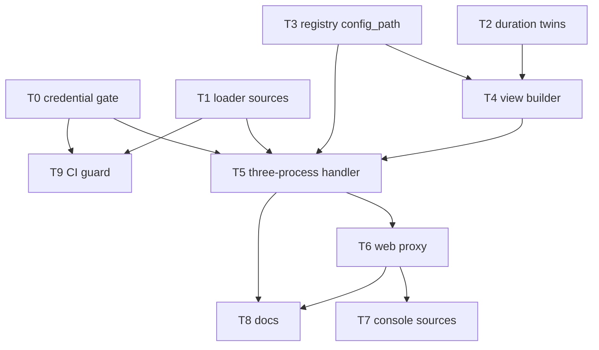

# Runtime Config View Implementation Plan

> **Status: executed.** All ten tasks landed on `feature/runtime-config-view`; the
> commit map, the six deliberate deviations and the two plan claims that proved
> wrong are recorded in `docs/design/runtime-config-view.md` §7. This document is
> kept as the plan of record — read §7 of the design doc before treating any step
> below as still unimplemented.

> **For agentic workers:** REQUIRED SUB-SKILL: Use
> `superpowers:subagent-driven-development` (recommended) or
> `superpowers:executing-plans` to implement this plan task-by-task. Steps use
> checkbox (`- [ ]`) syntax for tracking.

**Goal:** master / worker / transfer each expose their own effective full
configuration with per-item source annotation over HTTP; the admin console renders
the active master's view instead of its own startup snapshot.

**Architecture:** A shared view builder in `curvine-config` serializes the process'
`ClusterConf`, validates it for the matching load profile, overlays active runtime
overrides at their declared dotted configuration path, and cross-checks every
declared key against the document so phantom keys fail loudly instead of silently.
A shared axum handler in `curvine-web` mounts on all three processes; `curvine-web`
proxies the active master.

**Tech Stack:** Rust, `toml`, `serde_json`, axum, reqwest (already a dependency of
`curvine-web`), vitest + React Testing Library for the console.

## Global Constraints

- Baseline must be `origin/main-next`. The working branch is created from it; the
  `curvine-confmgr` branch is a mirror of `main-next` and owns no history.
- One task = one commit, and the workspace must stay compilable and green after
  every task.
- Write the failing test first, then the implementation, then run the target test.
- Never run a multi-crate `cargo check` / `cargo build` outside the final
  verification step: pulling `curvine-web` / `curvine-master` / `curvine-worker`
  together compiles `librocksdb-sys`, which takes >20 minutes. Use `-p <crate>`.
- No new third-party dependencies. `tempfile` is already in the workspace for tests
  that need a real config file on disk.
- `make format` before every commit.
- Commit subject format (internal track): `<type>(<scope>): <english subject> (<KEY>)`.
- Do not change journal / checkpoint persistence formats.
- Do not rename the shipped runtime keys `master.dir_space_enabled` /
  `master.dir_space_tracked_paths`; they are documented operator interfaces.
- `GET /api/v1/master/runtime` must keep its exact shape: `curvine-web` uses it for
  HA probing (`curvine-web/src/util/addr.rs` `master_runtime_scrape_url`, covered by
  a unit test).

---

## 1. File structure

### New files

| File | Responsibility |
| --- | --- |
| `crates/common/curvine-config/src/config_view.rs` | profile enum, view types, `effective_config_view`, JSON→TOML translation, phantom-key filtering |
| `crates/common/curvine-config/tests/from_with_sources_test.rs` | source-map contract for the loader |
| `crates/common/curvine-config/tests/config_view_test.rs` | view builder contract |
| `curvine-web/webui-next/src/pages/config-page.test.tsx` | console source rendering |

### Modified files

| File | Change |
| --- | --- |
| `crates/common/curvine-config/src/cluster_conf.rs` | `S3GatewayConf` credential gate; `from_with_sources` / `from_transfer_with_sources` |
| `crates/common/curvine-config/src/pipeline.rs` | `ConfigSource::Derived` |
| `crates/common/curvine-config/src/client_conf.rs` | 12 `_str` twins normalized |
| `crates/common/curvine-config/src/job_conf.rs` | 6 `_str` twins normalized |
| `crates/common/curvine-config/src/transfer_conf.rs` | 5 `_str` twins normalized, 3 of them fixed |
| `crates/common/curvine-config/src/runtime_registry.rs` | `config_path` on registry entries |
| `crates/common/curvine-config/src/lib.rs` | export `config_view` |
| `crates/common/curvine-config/Cargo.toml` | `[dev-dependencies] tempfile` |
| `crates/common/curvine-macros/tests/derive_client_cli.rs` | fixture follows the rename |
| `curvine-master/src/master/runtime_config.rs` | declare `config_path` for both dir-space keys |
| `curvine-worker/src/worker/runtime_config.rs` | declare `config_path` for 3 job keys, `None` for inflight budget |
| `curvine-web/src/router/runtime_config.rs` | full-view handler |
| `curvine-web/src/router/mod.rs` | export the handler |
| `curvine-web/src/router/admin_handler.rs` | `config_v1` proxies the active master; drop `config_sources` |
| `curvine-web/src/bin/curvine-web.rs` | stop the second file read; keep CLI source insertion |
| `curvine-web/src/server/admin_web_service.rs` | stop forwarding `config_sources` |
| `curvine-worker/src/worker/handler/router_handler.rs` | mount the full view |
| `curvine-worker/src/worker/worker_server.rs` | pass `(conf, sources)` |
| `crates/server/curvine-data-transfer/src/transfer/router_handler.rs` | mount the full view |
| `crates/server/curvine-data-transfer/src/transfer/transfer_server.rs` | pass `(conf, sources)` |
| `curvine-master/src/master/metrics_server.rs` | mount the full view, keep the old alias |
| `curvine-master/src/master/master_server.rs` | pass `(conf, sources)` |
| `curvine-server/src/bin/curvine-server.rs` | load with sources per service type |
| `curvine-web/webui-next/src/api/types.ts` | source union + response interface |
| `curvine-web/webui-next/src/pages/config-page.tsx` | source array, tones, whitelist |
| `curvine-web/webui-next/src/i18n/messages/modules/config.en.ts` | labels |
| `curvine-web/webui-next/src/i18n/messages/modules/config.zh-CN.ts` | labels |
| `curvine-web/webui-next/src/app.test.tsx` | stub + badge assertions |
| `curvine-web/docs/DEPLOY.md` | endpoint table |
| `etc/curvine-cluster.toml` | note the configuration path behind each shipped key |
| `.github/workflows/build.yml` | gate `cargo test -p curvine-config` on pull requests |
| `curvine-master/src/master/router_handler.rs` | deprecate the unbound `/api/config` |

---

## 2. Dependency graph



`T0`, `T1`, `T2`, `T3` have no mutual dependencies and may proceed in parallel.
`T2` and `T3` touch disjoint files. `T0` and `T1` both edit `cluster_conf.rs`, so
they are ordered rather than parallel.

---

## Task 0: Stop serializing S3 gateway credentials

**Files:**

- Modify: `crates/common/curvine-config/src/cluster_conf.rs`

**Interfaces:**

- Produces: `S3GatewayConf.access_key` / `secret_key` are deserialize-only. No
  signature changes.

- [ ] **Step 1: Measure the leak**

Add a temporary test asserting that a `ClusterConf` carrying credentials produces a
`to_pretty_toml()` string and a `serde_json::to_value()` value that both contain the
plaintext. Run it, confirm it passes (that is the bug), then delete it and confirm
`git status --porcelain` is empty.

- [ ] **Step 2: Gate both fields**

Add `#[serde(skip_serializing)]` to `access_key` and `secret_key` in
`S3GatewayConf`.

- [ ] **Step 3: Lock the behavior with a test**

Add `s3_gateway_credentials_are_not_serialized` in the `cluster_conf.rs` test
module: set both fields, assert `to_pretty_toml()` and `serde_json::to_value()`
contain neither plaintext, and assert `toml::from_str` still reads both back.

- [ ] **Step 4: Verify**

```bash
cargo test -p curvine-config s3_gateway_credentials_are_not_serialized
cargo test -p curvine-config
cargo check -p curvine-s3-gateway
```

Expected: all pass. `option_and_skip_serializing_fields_are_not_false_positives` in
`validation.rs` must stay green — it proves the unknown-key audit does not treat
skip-serializing fields as typos.

- [ ] **Step 5: Commit**

```bash
git add crates/common/curvine-config/src/cluster_conf.rs
git commit -m "fix(config): stop serializing s3 gateway credentials (<KEY>)"
```

---

## Task 1: Return a source map from the loader

**Files:**

- Modify: `crates/common/curvine-config/src/pipeline.rs`
- Modify: `crates/common/curvine-config/src/cluster_conf.rs`
- Modify: `crates/common/curvine-config/Cargo.toml`
- Create: `crates/common/curvine-config/tests/from_with_sources_test.rs`
- Modify: `curvine-web/src/bin/curvine-web.rs`

**Interfaces:**

- Produces:
  - `ConfigSource::Derived` (serialized as `derived`)
  - `ClusterConf::from_with_sources<T: AsRef<str>>(path: T) -> CommonResult<(Self, ConfigSourceMap)>`
  - `ClusterConf::from_transfer_with_sources<T: AsRef<str>>(path: T) -> CommonResult<(Self, ConfigSourceMap)>`
- `ClusterConf::from` / `from_transfer` keep their signatures and delegate.

- [ ] **Step 1: Write the failing test**

Create `crates/common/curvine-config/tests/from_with_sources_test.rs`. Use
`tempfile::NamedTempFile` for the config text. Cover:

- a file-supplied value maps to `ConfigSource::File`
- `CURVINE_MASTER_HOSTNAME` overrides it and maps to `ConfigSource::Env`
- a file with `master.web_port = 9000` and `web.port = 9000` yields effective 9010
  with `sources["master.web_port"] == ConfigSource::Derived`
- `client.master_addrs` is present and reported `Derived`
- under `from_transfer_with_sources`, a `master.hostname` env override does not
  apply while `transfer.hostname` does

Add `[dev-dependencies] tempfile = { workspace = true }` to
`crates/common/curvine-config/Cargo.toml`.

- [ ] **Step 2: Run it and confirm it fails**

```bash
cargo test -p curvine-config --test from_with_sources_test
```

Expected: compile error, `from_with_sources` does not exist.

- [ ] **Step 3: Implement**

Add the `Derived` variant to `ConfigSource`. Implement both loaders by running the
same post-deserialization chain as `from` / `from_transfer`, carrying the map from
`build_document_with_sources` / `build_transfer_document_with_sources`, and
inserting `Derived` where the value is actually mutated:

- `normalize_split_web_ports`: insert `Derived` for `master.web_port`
- `apply_hostname_overrides`: `Env` when the value came from an environment
  variable, `Derived` when it came from `net_interface`
- `resolve_master_addrs`: insert `Derived` for `client.master_addrs`

Refactor the shared tail into a private helper so `from` / `from_transfer` become
thin wrappers that drop the map.

- [ ] **Step 4: Use it in the web binary**

In `curvine-web/src/bin/curvine-web.rs`, replace `ClusterConf::from` plus the second
`pipeline::read_file_text` / `build_document_with_sources` call with a single
`from_with_sources`. Apply the `--hostname` / `--port` overrides and **still**
insert `ConfigSource::Cli` for `web.hostname` / `web.port` into the returned map.

- [ ] **Step 5: Verify**

```bash
cargo test -p curvine-config --test from_with_sources_test
cargo test -p curvine-config
cargo check -p curvine-web
```

- [ ] **Step 6: Commit**

```bash
git add crates/common/curvine-config curvine-web/src/bin/curvine-web.rs
git commit -m "refactor(config): return a source map from ClusterConf::from_with_sources (<KEY>)"
```

---

## Task 2: Serialize paired duration fields under base names

**Files:**

- Modify: `crates/common/curvine-config/src/client_conf.rs` (12 fields)
- Modify: `crates/common/curvine-config/src/job_conf.rs` (6 fields)
- Modify: `crates/common/curvine-config/src/transfer_conf.rs` (5 fields)
- Modify: `crates/common/curvine-macros/tests/derive_client_cli.rs`

**Interfaces:**

- No public API change. Serialized name becomes `<base>`; deserialization accepts
  both `<base>` and `<base>_str`.

**Why the new alias must keep the `_str` spelling:** the `client_cli` derive reads
`serde_alias` and ignores `rename` when computing the CLI long flag
(`crates/common/curvine-macros/src/client_cli.rs`, `field_kebab_name` /
`serde_alias`). All 20 existing pairs satisfy `alias == field_without_str`, so
keeping `<base>_str` as the alias leaves every CLI flag byte-identical.

- [ ] **Step 1: Record the baseline**

```bash
cargo test -p curvine-config
cargo test -p curvine-common-macros --test derive_client_cli
```

Expected: green. Note the counts so a later regression is attributable.

- [ ] **Step 2: Normalize the 20 existing pairs**

For each of the 20 fields that already carry `#[serde(alias = "<base>")]`, replace
the attribute with `#[serde(rename = "<base>", alias = "<base>_str")]`, keeping every
other attribute exactly as-is. The 20 are:

- `client_conf.rs`: `block_size_str`, `write_chunk_size_str`, `read_chunk_size_str`,
  `read_slice_size_str`, `storage_type_str`, `ttl_ms_str`, `ttl_action_str`,
  `ttl_type_str`, `read_ahead_len_str`, `drop_cache_len_str`,
  `small_file_size_str`, `large_file_size_str`
- `job_conf.rs`: `job_life_ttl_str`, `job_cleanup_ttl_str`, `terminal_retention_str`,
  `master_failed_load_job_retry_interval_str`, `task_timeout_str`,
  `task_report_interval_str`
- `transfer_conf.rs`: `lease_timeout_str`, `terminal_retention_str`

- [ ] **Step 3: Fix the three broken transfer knobs**

- `cluster_snapshot_max_staleness_str`: drop `skip` from its `#[serde(skip, default = ...)]` and use `#[serde(default = ..., rename = "cluster_snapshot_max_staleness", alias = "cluster_snapshot_max_staleness_str")]`
- `task_retention_str`: add `rename = "task_retention"` and `alias = "task_retention_str"`
- `worker_terminal_retention_str`: add `rename = "worker_terminal_retention"` and `alias = "worker_terminal_retention_str"`

Do **not** touch `task_stale_timeout` / `task_report_interval`: they are derived in
`TransferConf::init()` from `lease_timeout` and must stay unconfigurable.

- [ ] **Step 4: Add the tests**

- `toml_serializes_duration_base_names`: serialize a default `ClusterConf` and assert
  a representative path from each of the three files appears under its base name and
  that no `_str` suffix appears in the `client` / `job` / `transfer` sections
- `dead_transfer_knobs_accept_documented_names`: parse a TOML snippet setting the
  three fixed knobs by their base names, run `init()`, assert the resulting
  `Duration` values match — and assert no `unrecognized config key` path is reached
  by asserting `validation::audit_unknown_keys` returns empty

- [ ] **Step 5: Update the derive fixture**

`crates/common/curvine-macros/tests/derive_client_cli.rs` uses
`#[serde(alias = "block_size")] block_size_str`. Update it to the new attribute shape
so the fixture keeps exercising the same code path.

- [ ] **Step 6: Verify**

```bash
cargo test -p curvine-config
cargo test -p curvine-common-macros --test derive_client_cli
cargo test -p curvine-config --test transfer_conf_test
cargo test -p curvine-config --test client_conf_cli_test
```

- [ ] **Step 7: Commit**

Record in the body that process startup logging (`conf.print()` →
`to_pretty_toml`, called from `master_server.rs` and `worker_server.rs`) now prints
base names instead of `_str` names.

```bash
git add crates/common/curvine-config crates/common/curvine-macros/tests/derive_client_cli.rs
git commit -m "refactor(config): serialize paired duration fields under base names (<KEY>)"
```

---

## Task 3: Let registry entries declare their configuration path

**Files:**

- Modify: `crates/common/curvine-config/src/runtime_registry.rs`
- Modify: `curvine-master/src/master/runtime_config.rs`
- Modify: `curvine-worker/src/worker/runtime_config.rs`

**Interfaces:**

- Produces:
  - `RuntimeConfigRegistryBuilder::register_at(key, config_path: Option<&'static str>, file_value, effective, apply, reset) -> Self`
  - `RuntimeConfigRegistryBuilder::register(...)` unchanged in signature, delegates with `None`
  - `RuntimeConfigRegistry::config_path(&self, key: &str) -> Option<&'static str>` — the declared path, defaulting to the key; `None` for an unregistered key

- [ ] **Step 1: Write the failing test**

In the `runtime_registry.rs` test module: a registry built with `register_at(key,
Some("a.b.c"), ...)` reports `a.b.c`; one built with `register(key, ...)` reports the
key itself; an unregistered key reports `None`.

- [ ] **Step 2: Run it and confirm it fails**

```bash
cargo test -p curvine-config runtime_registry
```

- [ ] **Step 3: Implement**

Add `config_path: Option<&'static str>` to the entry record, add `register_at`, make
`register` delegate, and add the accessor.

- [ ] **Step 4: Declare paths in master**

`curvine-master/src/master/runtime_config.rs`: the two dir-space entries declare
`Some("master.dir_space.enabled")` and `Some("master.dir_space.tracked_paths")`.

- [ ] **Step 5: Declare paths in worker**

`curvine-worker/src/worker/runtime_config.rs`:

- `worker_max_concurrent_tasks` → `Some("job.worker_max_concurrent_tasks")`
- `task_timeout` → `Some("job.task_timeout")`
- `task_report_interval` → `Some("job.task_report_interval")`
- `transfer_inflight_budget_bytes` → `None` (no configuration-file entry; stays
  writable but is not displayed)

- [ ] **Step 6: Verify**

```bash
cargo test -p curvine-config runtime_registry
cargo test -p curvine-master runtime_config
cargo test -p curvine-worker runtime_config
```

- [ ] **Step 7: Commit**

```bash
git add crates/common/curvine-config/src/runtime_registry.rs \
  curvine-master/src/master/runtime_config.rs \
  curvine-worker/src/worker/runtime_config.rs
git commit -m "refactor(config): let registry entries declare their dotted config path (<KEY>)"
```

---

## Task 4: Build the effective config view

**Files:**

- Create: `crates/common/curvine-config/src/config_view.rs`
- Modify: `crates/common/curvine-config/src/lib.rs`
- Create: `crates/common/curvine-config/tests/config_view_test.rs`

**Interfaces:**

- Produces:
  - `pub enum ViewProfile { Full, Transfer }`
  - `pub struct RuntimeEntryView { pub key: String, pub path: String, pub file_value: Value, pub override_value: Option<Value>, pub effective_value: Value }`
  - `pub struct ConfigView { pub values: Value, pub sources: BTreeMap<String, ConfigSource>, pub runtime: Vec<RuntimeEntryView>, pub writable: Vec<String>, pub unresolved: Vec<String> }`
  - `pub fn effective_config_view(conf: &ClusterConf, profile: ViewProfile, registry: &RuntimeConfigRegistry, base_sources: &ConfigSourceMap) -> CommonResult<ConfigView>`

- [ ] **Step 1: Write the failing tests**

Each case below reproduced a real failure during design review:

1. `override_lands_on_declared_config_path` — registry entry declaring
   `master.dir_space.enabled` with an override of `true` makes
   `values.master.dir_space.enabled == true` and
   `sources["master.dir_space.enabled"] == ConfigSource::Runtime`
2. `phantom_key_is_excluded_and_reported` — a registry entry declaring a path absent
   from the tree appears in `unresolved`, not in `values` / `sources` / `writable` /
   `runtime`
3. `duration_overlay_survives_validation` — overriding `job.task_timeout` with
   `"1800000ms"` yields a non-zero effective duration; without validation it is `0ns`
4. `array_overlay_translates_json_string` — overriding a `Vec<String>` path with
   `"[\"/a\"]"` deserializes successfully
5. `base_sources_survive_when_no_override` — with an empty override set, `sources` is
   identical to `base_sources`
6. `entry_without_config_path_is_writable_but_hidden` — `config_path == None` appears
   in `writable`, not in `runtime` or `values`

- [ ] **Step 2: Run them and confirm they fail**

```bash
cargo test -p curvine-config --test config_view_test
```

Expected: compile error, module absent.

- [ ] **Step 3: Implement the pipeline**

1. `toml::Value::try_from(conf)` → base document
2. For each registered key with an active override and a declared path:
   translate the JSON value to `toml::Value` and `pipeline::set_dotted` it into the
   document
3. Deserialize back into `ClusterConf` and validate for the profile:
   `Full` → `conf.validate()`; `Transfer` → `client.validate()` + `transfer.validate()`
   (`ConfValidate` lives in `curvine_config::validation`)
4. `serde_json::to_value` → `values`; build `sources` from `base_sources`, adding
   `Runtime` for each overridden path; filter with
   `validation::audit_unknown_keys_in(&doc)` so any declared path the tree does not
   consume is dropped from every list and logged via `warn!`

Implement `fn translate(raw: &str) -> toml::Value`: try `serde_json::from_str` then
`toml::Value::try_from` (handles `true`, `64`, `[...]`), falling back to
`toml::Value::String` (handles `"1800000ms"`).

- [ ] **Step 4: Export the module**

`crates/common/curvine-config/src/lib.rs`: `pub mod config_view;` plus re-exports of
`effective_config_view`, `ConfigView`, `RuntimeEntryView`, `ViewProfile`.

- [ ] **Step 5: Verify**

```bash
cargo test -p curvine-config --test config_view_test
cargo test -p curvine-config
cargo clippy -p curvine-config --all-targets -- -D warnings
```

- [ ] **Step 6: Commit**

```bash
git add crates/common/curvine-config
git commit -m "feat(config): build a process-scoped effective config view (<KEY>)"
```

---

## Task 5: Expose the view on every process

**Files:**

- Modify: `curvine-web/src/router/runtime_config.rs`
- Modify: `curvine-web/src/router/mod.rs`
- Modify: `curvine-worker/src/worker/handler/router_handler.rs`
- Modify: `curvine-worker/src/worker/worker_server.rs`
- Modify: `crates/server/curvine-data-transfer/src/transfer/router_handler.rs`
- Modify: `crates/server/curvine-data-transfer/src/transfer/transfer_server.rs`
- Modify: `curvine-master/src/master/metrics_server.rs`
- Modify: `curvine-master/src/master/master_server.rs`
- Modify: `curvine-server/src/bin/curvine-server.rs`

**Interfaces:**

- Produces:
  - `pub struct ConfigViewState { pub role: &'static str, pub node: String, pub conf: Arc<ClusterConf>, pub profile: ViewProfile, pub sources: ConfigSourceMap, pub registry: Arc<RuntimeConfigRegistry> }`
  - `pub async fn get_config_view(Extension(state): Extension<Arc<ConfigViewState>>) -> RuntimeConfigHttpResult<Json<Value>>`
- Consumes: `effective_config_view` from Task 4.

### Route decisions

| Process | New route | Kept as-is |
| --- | --- | --- |
| master | `GET /api/v1/master/config` | `GET /api/v1/master/runtime/config` (alias for one release), `GET /api/v1/master/runtime` (**frozen**, HA probe), `POST /api/update_config` |
| worker | `GET /api/v1/worker/config` (body widened) | `POST /api/update_config` |
| transfer | `GET /api/v1/transfer/config` (body widened) | `POST /api/update_config` |

The worker/transfer route path is unchanged; only the response body grows from a
flat key/value map into the full view. That is an additive change for the sole
in-repo consumer (the endpoint tests).

- [ ] **Step 1: Write the failing tests**

One endpoint test per process, following the existing patterns:

- worker/transfer: `tower::ServiceExt::oneshot` against the router, as in
  `curvine-worker/src/worker/handler/tests/runtime_config_test.rs`
- master: build `MasterMetricsHandler` as in `metrics_server.rs`'s test module

Each asserts the body has `role`, `node`, `values`, `sources`, `runtime`, `writable`,
`persistent`, and that a known configuration leaf is present in `values`.

- [ ] **Step 2: Implement the shared handler**

In `curvine-web/src/router/runtime_config.rs`, add `ConfigViewState` and
`get_config_view`. Keep the existing `get_runtime_config` / `runtime_config_view` /
`post_update_config` untouched — they still back `POST /api/update_config` and the
legacy route. Export the new items from `curvine-web/src/router/mod.rs`.

- [ ] **Step 3: Mount on the three processes**

Each process needs `(conf: Arc<ClusterConf>, sources: ConfigSourceMap)` reachable
from its `WebHandlerService::get_handler`. Thread the pair through:

- `WorkerService::with_conf` already receives `&ClusterConf`; add the source map, add
  the fields to `WorkerRouterHandler`, mount the route
- `TransferRpcService` likewise
- `MasterMetricsServer::with_rt` gains the source map and an `Arc<ClusterConf>`

- [ ] **Step 4: Load with sources in the server binary**

`curvine-server/src/bin/curvine-server.rs` currently selects
`ClusterConf::from_transfer` for `Transfer` and `ClusterConf::from` otherwise.
Switch to the `*_with_sources` variants and pass the map into each service
constructor.

- [ ] **Step 5: Keep the master alias**

Mount `/api/v1/master/runtime/config` on the same handler function so existing curl
recipes keep working for one release. Do **not** touch `/api/v1/master/runtime`.

- [ ] **Step 6: Verify**

```bash
cargo test -p curvine-worker runtime_config
cargo test -p curvine-master metrics_server
cargo test -p curvine-data-transfer
cargo check -p curvine-web
cargo check -p curvine-server
```

- [ ] **Step 7: Commit**

```bash
git add curvine-web/src/router curvine-worker/src crates/server/curvine-data-transfer/src \
  curvine-master/src curvine-server/src
git commit -m "feat(config): expose a full effective config view on every process (<KEY>)"
```

---

## Task 6: Serve the console from the active master

**Files:**

- Modify: `curvine-web/src/router/admin_handler.rs`
- Modify: `curvine-web/src/bin/curvine-web.rs`
- Modify: `curvine-web/src/server/admin_web_service.rs`

**Interfaces:**

- `config_v1` keeps its route (`GET /api/v1/config`) and success shape
  (`api_success(full_view)`).
- New failure shape: `api_error_response(StatusCode::BAD_GATEWAY, "MASTER_CONFIG_UNAVAILABLE", message)`.

- [ ] **Step 1: Write the failing test**

Cover the failure path deterministically without network access: point the handler
at an unroutable master address and assert the response body is
`{"success": false, "error": {"code": "MASTER_CONFIG_UNAVAILABLE", ...}}`. Add a
success-path test by extracting the fetch into a small helper that takes a
`reqwest::Client` plus URL, mirroring how
`fetch_master_runtime_info_with_client` is testable today.

- [ ] **Step 2: Implement**

`config_v1` resolves the active master through the existing
`current_master_info(instance)` path, derives the scrape host/port through
`curvine-web/src/util/addr.rs` (`resolve_master_scrape_hostname`,
`master_scrape_web_port`), and fetches
`http://{host}:{port}/api/v1/master/config` with
`master_runtime_http_client()`. Map any transport error, non-2xx status or JSON
failure to the `502` envelope above.

The response **must** go through `api_error_response`: the console's
`unwrap()` in `curvine-web/webui-next/src/api/http.ts` only surfaces
`error.code` when `success === false`.

- [ ] **Step 3: Remove the dead `config_sources` plumbing**

Delete the field and its four touch points in `admin_handler.rs`, the
`with_sources` plumbing in `admin_web_service.rs`, and the manual source assembly in
`curvine-web.rs` — Task 1 already removed the second file read there.

- [ ] **Step 4: Verify**

```bash
cargo test -p curvine-web
cargo check -p curvine-web
```

- [ ] **Step 5: Commit**

```bash
git add curvine-web/src
git commit -m "refactor(web): serve the config page from the active master view (<KEY>)"
```

---

## Task 7: Render runtime and derived sources in the console

**Files:**

- Modify: `curvine-web/webui-next/src/api/types.ts`
- Modify: `curvine-web/webui-next/src/pages/config-page.tsx`
- Modify: `curvine-web/webui-next/src/i18n/messages/modules/config.en.ts`
- Modify: `curvine-web/webui-next/src/i18n/messages/modules/config.zh-CN.ts`
- Modify: `curvine-web/webui-next/src/app.test.tsx`
- Create: `curvine-web/webui-next/src/pages/config-page.test.tsx`

**Interfaces:**

- `ConfigSource` gains `'runtime' | 'derived'`.
- `ConfigData` gains optional `role`, `node`, `runtime`, `writable`, `persistent`.

**There are five edit sites, not two.** Missing `configSourceFor` silently demotes
any unknown source to `default` — the same class of bug as §2.1 in the design.

| Site | Change |
| --- | --- |
| `types.ts` source union | add both variants |
| `types.ts` response interface | add the five optional fields |
| `config-page.tsx` `CONFIG_SOURCES` | add both entries |
| `config-page.tsx` `SOURCE_TONES` | `runtime` → `positive`, `derived` → `neutral` |
| `config-page.tsx` `configSourceFor` | add both to the whitelist |
| i18n (en + zh-CN) | `sources.runtime`, `sources.derived` |

- [ ] **Step 1: Update existing assertions**

`app.test.tsx` stubs `fetchConfigData` and asserts four badge labels plus an
`Environment (1)` filter count. Add a `runtime` and a `derived` entry to the stub and
update the affected assertions.

- [ ] **Step 2: Write the new test file**

`config-page.test.tsx`: an unknown source string renders as Default; `runtime`
renders the Runtime badge; filtering by runtime leaves exactly the runtime entries.

- [ ] **Step 3: Verify**

Node is not on `PATH` but is installed under `~/.nvm/versions/node/v22.21.0`, so this
task is verifiable locally after all:

```bash
export PATH="$HOME/.nvm/versions/node/v22.21.0/bin:$PATH"
cd curvine-web/webui-next
npm run type-check && npm run test
```

CI (`.github/workflows/webui-checks.yml`) remains the authoritative gate:
`npm ci --include=dev && npm run type-check && npm run test && npm run build`.

- [ ] **Step 4: Commit**

```bash
git add curvine-web/webui-next/src
git commit -m "feat(webui): render runtime and derived config sources (<KEY>)"
```

---

## Task 8: Documentation

**Files:**

- Create: `docs/design/runtime-config-view.md`
- Create: `docs/plans/runtime-config-view-implementation.md`
- Modify: `curvine-web/docs/DEPLOY.md`
- Modify: `etc/curvine-cluster.toml`

- [ ] **Step 1: Force-add the docs**

`/docs` is ignored by `.gitignore`, so tracked docs there were added with `-f`
(see `94ee7760 docs(master): reconstruct dir-space design and plan`):

```bash
git add -f docs/design/runtime-config-view.md docs/plans/runtime-config-view-implementation.md
```

- [ ] **Step 2: Extend the endpoint table**

`curvine-web/docs/DEPLOY.md` already documents `[web].port` = 9000 for the console
and `[master].web_port` = 9010 as the observability port. Add rows for
`GET /api/v1/{role}/config` and `POST /api/update_config`, and state explicitly that
9010 carries **no authentication** and is intended for internal scraping only.

- [ ] **Step 3: Note the configuration path behind each shipped key**

In `etc/curvine-cluster.toml`, after the existing comment naming
`master.dir_space_enabled` / `master.dir_space_tracked_paths`, add that the
corresponding configuration paths are `master.dir_space.enabled` /
`master.dir_space.tracked_paths`. The keys themselves do not change.

- [ ] **Step 4: Verify**

```bash
cargo test -p curvine-config workspace_sample_config_audits_clean
git status --porcelain   # only the four intended files
```

- [ ] **Step 5: Commit**

```bash
git add -f docs/design/runtime-config-view.md docs/plans/runtime-config-view-implementation.md
git add etc/curvine-cluster.toml curvine-web/docs/DEPLOY.md
git commit -m "docs(web): document process-scoped config endpoints (<KEY>)"
```

---

## Task 9: CI guard and dead-route annotation

**Files:**

- Modify: `.github/workflows/build.yml`
- Modify: `curvine-master/src/master/router_handler.rs`

- [ ] **Step 1: Gate the config crate on pull requests**

Today `cargo test -p curvine-config` only runs in the daily job, which is why a
20-field serialization change could land untested. Add a step after `Run clippy`:

```yaml
- name: Config crate tests
  run: cargo test -p curvine-config --jobs ${{ env.CARGO_BUILD_JOBS }}
```

- [ ] **Step 2: Annotate the unbound full-config route**

`MasterRouterHandler::router()` serves `GET /api/config` returning the whole
`ClusterConf`. `grep MasterRouterHandler` outside that file returns nothing, so the
router is never bound — but the code compiles into the binary. Add a doc comment
marking it deprecated and pointing at `/api/v1/master/config`. Task 0 already
removes the credential leak from its payload.

- [ ] **Step 3: Verify**

```bash
cargo fmt --check
cargo clippy -p curvine-master --all-targets -- -D warnings
```

- [ ] **Step 4: Commit**

```bash
git add .github/workflows/build.yml curvine-master/src/master/router_handler.rs
git commit -m "ci: gate curvine-config tests on pull requests (<KEY>)"
```

---

## 3. Verification matrix

| Task | Local gate | CI-only |
| --- | --- | --- |
| 0 | `cargo test -p curvine-config`, `cargo check -p curvine-s3-gateway` | — |
| 1 | `cargo test -p curvine-config`, `cargo check -p curvine-web` | — |
| 2 | `cargo test -p curvine-config`, `-p curvine-common-macros --test derive_client_cli` | — |
| 3 | `cargo test -p curvine-config`, `-p curvine-master`, `-p curvine-worker` | — |
| 4 | `cargo test -p curvine-config --test config_view_test`, clippy | — |
| 5 | `cargo test -p curvine-worker`, `-p curvine-master`, `-p curvine-data-transfer`, `cargo check -p curvine-server` | full `cargo build` |
| 6 | `cargo test -p curvine-web` | full `cargo build` |
| 7 | `npm run type-check && npm run test` under `~/.nvm/versions/node/v22.21.0/bin` | `webui-checks.yml` (also runs `npm run build`) |
| 8 | `cargo test -p curvine-config workspace_sample_config_audits_clean` | — |
| 9 | `cargo fmt --check`, `cargo clippy -p curvine-master` | first run of the new step |

Per-commit gate: `make format` → target-crate `cargo test` →
`cargo clippy -p <crate> --all-targets -- -D warnings`.

## 3a. Single-node end-to-end run

Run on 2026-10-26 against `feature/runtime-config-view` at `f5f7013f`, on one host
with `testing/conf/curvine-single.toml` (git-ignored; derived from
`etc/curvine-cluster.toml` with master/worker/transfer ports separated).

| # | Probe | Observed |
| --- | --- | --- |
| E1 | `GET :9010/api/v1/master/config` | `role=master`, `node=127.0.0.1:9010`, 2 runtime entries, `unresolved=[]`, 43 sources |
| E2 | Same body scanned for credentials | `access_key` / `secret_key` absent from the whole payload, and from `values.s3_gateway` (10 keys left) |
| E3 | `POST :9010/api/update_config?master.dir_space_enabled=true` | `previous_value=false`, `value=true`; re-read shows `values.master.dir_space.enabled=true` and `sources[...]="runtime"` |
| E4 | `POST ...?master.dir_space_tracked_paths=["/probe"]` (JSON string) | translated into a TOML array; view shows `tracked_paths=["/probe"]`, source `runtime` |
| E5 | `POST ...?master.bogus=1` | 422 |
| E6 | `POST ...?a=1&b=2` | 422 `exactly one config_name=value parameter is required` |
| E7 | `GET :9002/api/v1/worker/config` | `writable` lists all four worker keys; three appear in `runtime[]` with `path` under `job.*`; `transfer_inflight_budget_bytes` is writable but absent from `runtime[]` (no config-file entry) |
| E8 | `GET :9004/api/v1/transfer/config` | `writable=[]`, `runtime=[]`, `transfer.lease_timeout=120s` visible, no credentials |
| E9 | Console `GET :9000/api/v1/config` without a cookie | 401 `UNAUTHORIZED` (the proxy inherits session auth) |
| E10 | Console `GET :9000/api/v1/config` with a cookie, master up | proxies the master view; `sources` carries `file`/`derived`/`runtime`; `master.web_port=file`, `client.master_addrs=derived` |
| E11 | Master killed, then console `GET :9000/api/v1/config` | **500 with a bare `{"message": ...}`** — a real defect, fixed in `f5f7013f`; now 502 `MASTER_CONFIG_UNAVAILABLE` in the standard envelope |
| E12 | Worker override `worker_max_concurrent_tasks=32`, `task_timeout=1800000ms` | `update_config` reports `previous_value=100` / `3600000`; view then shows `32` / `1800000ms` with source `runtime` |
| E13 | Master override after restarting it, read back through the console | console shows `values.master.dir_space.enabled=true`, source `runtime` — override propagates through the proxy |
| E14 | `GET :9010/api/v1/master/runtime/config` (legacy alias) | still answers with the view |
| E15 | `GET :9010/api/v1/master/runtime` (frozen HA probe) | unchanged liveness payload |

Startup wrinkle worth documenting: `[journal]` needs an explicit
`hostname`/`rpc_port`, because the raft node's local address must appear verbatim
in `journal.journal_addrs` or the master exits with `Not a master role`. The
sample file relies on the `localhost` default, so a single-host run with
`127.0.0.1` everywhere needs both keys spelled out.

## 3b. Follow-on verification (commits 14–17)

Re-run on 2026-10-27 against the same single-host cluster, after the console gained a
write path and the RPC limits became live. `CURVINE_WEB_PASSWORD` has to be exported
for a console session; there is no default password.

| # | Probe | Observed |
| --- | --- | --- |
| F1 | `GET :9010/api/v1/master/config` | `writable=[master.conn_limit, master.dir_space_enabled, master.dir_space_tracked_paths, master.global_limit]` |
| F2 | `POST :9010/api/update_config?master.conn_limit=17` | `previous_value=8`, `value=17`; re-read `effective_value=17 override_value=17 file_value=8`, `sources[master.conn_limit]=runtime` |
| F3 | `POST :9010/api/update_config?master.global_limit=512` | `previous_value=4096`; `healthz` still 200 — the shrink does not strand the server |
| F4 | `POST` with an empty value for `master.conn_limit` | 422 `master.conn_limit expects an integer: ` |
| F5 | `POST ?master.conn_limit` with no value | reset: `effective_value=8`, `override_value=None`, source no longer overridden |
| F6 | `GET :9004/api/v1/transfer/config` | `writable=[worker_max_concurrent_tasks]`, `runtime[]` shows the live 100 |
| F7 | `POST :9004/api/update_config?worker_max_concurrent_tasks=7` | `previous_value=100`; view then `effective=7 override=7 file=100`, source `runtime`; `readyz` 200 |
| F8 | Console `POST :9000/api/v1/config {"key":"master.conn_limit","value":"23"}` | `previous_value=8 value=23 reset=false`; master direct and console both re-read 23 with source `runtime` |
| F9 | Console `POST :9000/api/v1/config {"key":"master.conn_limit"}` (no `value`) | `effective_value=8`, `reset=true`; master re-reads 8 with no override |
| F10 | Console `POST :9000/api/update_config` (the `key=value` form) | 405 — the console writes only through `POST /api/v1/config` with a JSON body |
| F11 | Config-page vitest suite | 3 cases pass, including `filters config entries by the runtime source` |

Two properties of the live limits are not obvious from the contract:

- A shrink below the in-flight count does not interrupt accepted work. Idle permits
  are withdrawn at once; permits held by in-flight requests are reclaimed as they are
  released, so the effective ceiling converges instead of dropping immediately.
- Resetting through the console and resetting through a process port are the same
  operation; both leave `persistent=false`, so a restart returns to the file value.

## 4. Risks and accepted limitations

| # | Risk | Handling |
| --- | --- | --- |
| R1 | Task 2 changes the field names in both processes' startup logs | Called out in the commit body; operators grepping startup output must be told |
| R2 | Task 2 makes three previously inert `transfer` knobs take effect | Low: the wrong spelling currently logs `unrecognized config key` and keeps defaults; Task 2 Step 4 pins the new behavior |
| R3 | No section pruning | Explicit P2 item; measured consumer matrix recorded in the design doc |
| R4 | 9010 has no authentication | Task 0 removes credentials first; `DEPLOY.md` states the internal-only intent; token auth is P2 |
| R5 | The console has a session but no RBAC | Out of P1 scope; `update_config` inherits session auth via `/api/`, which is still better than the bare 9010 route |
| R6 | ~~No Node toolchain on dev boxes~~ — resolved, Node lives at `~/.nvm/versions/node/v22.21.0` and Task 7 was verified locally (316 tests) | keep using that prefix; `webui-checks.yml` still authoritative |
| R7 | Multi-crate Rust builds are effectively unusable locally | Always `-p <crate>`; full build only at Tasks 5–6 |
| R8 | The design doc previously lived only in an ignored directory and drifted 15 relevant commits | Task 8 tracks it; Task 9 gates the crate in PR CI |

## 5. Assumptions that are cheap to reverse

| # | Assumption | Cost to flip |
| --- | --- | --- |
| A1 | The two shipped dir-space keys keep their names; `config_path` maps them to real paths | two constants, five test literals, one comment |
| A2 | P1 shows only the master view in the console; worker/transfer endpoints exist but are not selectable | one node selector in the console (P2) |
| A3 | `derived` is a sixth source label rather than misreporting derived values as `file` | remove the variant and three inserts |
| A4 | ~~The master `conn_limit` / `global_limit` hot-reload pilot is **not** part of this plan~~ — superseded: commit 15 replaced the pilot's approach instead of merging it | revert commits 15–17; the pilot branch `feat/master-runtime-config-pilot` still exists but conflicts with `main-next` |
| A5 | Worker `transfer_inflight_budget_bytes` stays out of the view | would need a real configuration field first |
| A6 | `POST /api/update_config` keeps the single `key=value` form | P2 |

## 6. Preconditions

1. A CoMind implementation sub-issue KEY under parent `#1001228155`; every commit
   carries it.
2. Branch off `origin/main-next`; never push to `main-next` directly.
3. Clean working tree; `stash@{0}` (WIP on `main-next`, touching `build/build.sh`
   and the webui dependency files) is unrelated and stays untouched.
